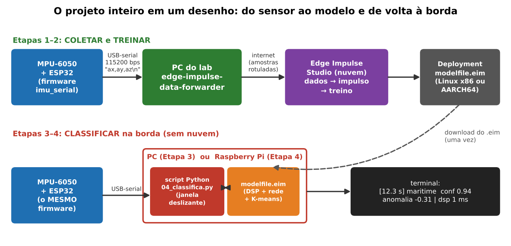
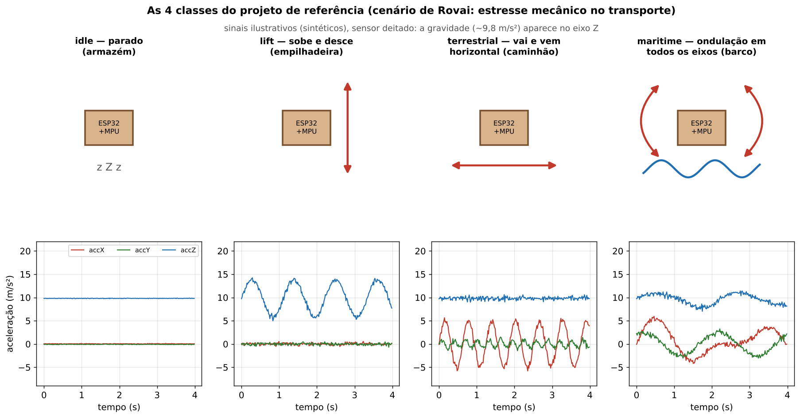

# Projeto guiado — Reconhecimento de movimentos contínuos com Edge Impulse

**ESP32 + MPU-6050 → PC → Edge Impulse Studio → inferência no PC → inferência no Raspberry Pi**

Este é o projeto que fecha o semestre. Em **4 encontros de 4 aulas (4 × 50 min = 200 min cada)**,
cada bancada vai construir, do zero, um sistema que **reconhece o tipo de movimento** de uma
"carga" (o seu ESP32 com o acelerômetro) usando aprendizado de máquina — e vai rodar esse
reconhecimento **na borda**, sem nuvem: primeiro no PC do laboratório e, por fim, num
computador de placa única (Raspberry Pi).

> 🎯 **Tudo o que você precisa está nesta pasta.** Os roteiros repetem de propósito a teoria e os
> comandos que já apareceram em outras semanas (I²C, temporizadores, semáforos, amostragem), para
> que você não precise ficar pulando de arquivo em arquivo. Onde houver material mais
> aprofundado, há um link "para ir além" — mas ele é **opcional**.



*Figura P-1 — O projeto inteiro. Em cima (Etapas 1–2), os dados saem do sensor e vão para a nuvem,
onde o modelo é treinado. Embaixo (Etapas 3–4), o modelo "desce" como um programa (`.eim`) e
classifica os dados **localmente**, em tempo real.*

---

## O problema que vamos resolver

Usaremos o cenário do professor **Marcelo Rovai** (UNIFEI/TinyML4D), o mesmo do projeto de
referência da disciplina: **monitorar o estresse mecânico de uma carga durante o transporte**.
Uma caixa com um acelerômetro "sabe" se está:

| Classe | Situação real | Como simular com a bancada |
|---|---|---|
| `idle` | parada no armazém | ESP32 em repouso sobre a mesa |
| `lift` | sendo erguida por uma empilhadeira | movimento **vertical** de sobe-e-desce |
| `terrestrial` | num caminhão ou trem | vai-e-vem **horizontal**, numa linha |
| `maritime` | num navio | ondulação lenta **em todos os eixos** (balanço de barco) |

Distinguir esses movimentos com `if`s escritos à mão é muito difícil (cada pessoa move de um
jeito, a velocidade varia, a orientação muda). Por isso vamos **aprender** a regra a partir de
exemplos — isso é aprendizado de máquina.



*Figura P-2 — As quatro classes e a "cara" que cada uma tem no acelerômetro (sinais
ilustrativos). Repare: em `idle` só aparece a gravidade (≈ 9,8 m/s² no eixo Z); em `lift`, o Z
oscila; em `terrestrial`, o X oscila; em `maritime`, tudo ondula devagar.*

> 🔎 **Projeto de referência do professor** (público):
> <https://studio.edgeimpulse.com/public/509253/live> — *"Aula 1 - Reconhecimento de movimentos
> contínuos - Versão 2"*: 4 classes (`idle`, `lift`, `maritime`, `terrestrial`), acelerômetro
> com eixos `accX, accY, accZ` a **62,5 Hz**, janela de **2000 ms** com incremento de **80 ms**,
> bloco *Spectral Analysis*, classificador por rede neural e detecção de anomalias (K-means).
> Na Etapa 1 você vai **cloná-lo** para a sua conta e explorá-lo antes de construir o seu.

---

## As 4 etapas (e os 4 encontros)

| Encontro (200 min) | Etapa | O que você faz | Termina quando… |
|---|---|---|---|
| **1** | [Etapa 1 — Aprendizado de máquina embarcado e o Edge Impulse Studio](etapa-1-studio.md) | Teoria essencial de ML embarcado; conta no Edge Impulse; clona e explora o projeto de referência; treina um modelo com o **celular** como sensor; instala as ferramentas no PC | ✅ modelo do celular classificando ao vivo + `edge-impulse-data-forwarder --version` funcionando no PC |
| **2** | [Etapa 2 — Ingestão de dados: ESP32 → PC → Edge Impulse](etapa-2-ingestao.md) | Firmware que serializa o MPU-6050 a 62,5 Hz; *data forwarder*; coleta das 4 classes; impulso, treino, teste e detecção de anomalias com os **seus** dados | ✅ modelo treinado com dados do ESP32, matriz de confusão do conjunto de teste anotada |
| **3** | [Etapa 3 — Classificação na borda: PC desktop](etapa-3-inferencia-pc.md) | Scripts Python: leitura serial → extração de *features* → janela deslizante → classificação em tempo real com o `.eim` | ✅ terminal do PC classificando os movimentos do ESP32 em tempo real |
| **4** | [Etapa 4 — Classificação na borda: Raspberry Pi](etapa-4-rpi.md) | Instala o Raspberry Pi OS, acessa por SSH, prepara o Python, copia scripts e modelo e roda a classificação **no RPi** | ✅ RPi classificando os movimentos do ESP32 + entrega no GitHub |

> ⏱️ **Ritmo.** Cada roteiro traz o tempo sugerido de cada parte. Se sua bancada atrasar, as
> partes marcadas como **(opcional)** podem ser puladas sem prejudicar a sequência. Se o
> hardware falhar, há um **simulador** (`src/python/simulador_imu.py`) que imita o ESP32 para
> testar os scripts das Etapas 3 e 4.

**Problemas?** Consulte o [guia de problemas](guia-problemas.md) — ele está organizado por
sintoma (a mensagem que aparece na tela).

---

## Algumas padronizações — leia antes de começar

Um modelo de aprendizado de máquina só funciona com dados **parecidos com os do treino**. Por
isso, estes parâmetros valem para **todo** o projeto — firmware, Studio, scripts do PC e do RPi:

| Parâmetro | Valor | Onde aparece |
|---|---|---|
| Taxa de amostragem | **62,5 Hz** (uma amostra a cada **16 ms**) | firmware (`PERIODO_US 16000`), *data forwarder* (`--frequency 62.5`), Studio (*Frequency*) |
| Eixos e ordem | `accX, accY, accZ` | firmware (`printf`), *data forwarder* (nomes dos eixos), Studio |
| Unidade | **m/s²** (repouso: Z ≈ +9,8) | firmware (`× 9,80665`) |
| Fundo de escala do MPU-6050 | **±4 g** | firmware (`MPU_RANGE 1`) |
| Filtro interno (DLPF) | ≈ 21 Hz (anti-*aliasing*) | firmware (`MPU_DLPF 4`) |
| Janela | **2000 ms = 125 amostras** | Studio (*Window size*); scripts leem do próprio modelo |
| Montagem do sensor | **sempre a mesma** (ex.: protoboard deitada, fios para o mesmo lado) | coleta **e** uso |

> ⚠️ **Erro nº 1 de projetos assim:** mudar uma linha dessa tabela num lugar só (por exemplo,
> trocar a taxa no firmware e esquecer o Studio). O modelo continua "funcionando" — só que
> errando tudo, sem nenhuma mensagem de erro.

---

## Materiais por bancada

| Item | Observação |
|---|---|
| ESP32 DevKit + cabo USB **de dados** | o mesmo dos labs anteriores |
| Módulo MPU-6050 (GY-521) + 4 jumpers | ligação idêntica à do Lab 9 |
| Protoboard | serve de "caixa" da carga |
| PC do laboratório (Ubuntu 24.04) | com ESP-IDF v5.2 (já instalado nas semanas anteriores) |
| Celular com navegador | só na Etapa 1 |
| Conta gratuita no [Edge Impulse](https://edgeimpulse.com/signup) | uma por aluno; o projeto da bancada pode ser compartilhado |
| Raspberry Pi 3 Model B + fonte micro-USB ≥ 2,5 A + cartão microSD ≥ 16 GB | Etapa 4 |
| Leitor de cartão SD | Etapa 4 (gravar o sistema) |

---

## Arquivos desta pasta

```
projeto-guiado-movimento/
├── README-projeto-guiado.md      ← este arquivo (visão geral, contrato, entrega)
├── etapa-1-studio.md             ← teoria de ML embarcado + Edge Impulse Studio
├── etapa-2-ingestao.md           ← firmware ESP32, data forwarder, coleta, treino, teste
├── etapa-3-inferencia-pc.md      ← scripts Python e classificação em tempo real no PC
├── etapa-4-rpi.md                ← Raspberry Pi: sistema, SSH, Python e classificação
├── guia-problemas.md             ← sintoma → causa → remédio
├── gabarito/                     ← soluções dos scripts 02–04 (para conferência)
├── src/
│   ├── imu_serial/               ← projeto ESP-IDF completo (firmware de serialização)
│   ├── python/                   ← 01_leitor_serial.py, 02–04 (com TODOs), simulador, cubo 3D
│   ├── scripts/                  ← instalar_ferramentas_pc.sh, instalar_rpi.sh
│   └── figuras/gera_figuras.py   ← gera as figuras pgm_*.png
└── tests/                        ← teste automático dos scripts (simulador + .eim falso)
```

---

## Entrega (GitHub da bancada, pasta `projeto-guiado/`)

Como nos labs, a entrega é **por commit** no repositório da bancada, com commits pequenos ao
longo dos 4 encontros (não um commit só no final). O trabalho é feito direto em `~/sis-emb/projeto-guiado/`
(o diretório da bancada sincronizado com o GitHub — ver [`docs/instalacao.md`](../docs/instalacao.md), seção 5).

```
projeto-guiado/
├── relatorio.md                 ← respostas das perguntas marcadas com 📝 nos 4 roteiros
├── imu_serial/                  ← o projeto do firmware (SEM a pasta build/)
├── python/                      ← 02_extrai_features.py, 03_janela_deslizante.py, 04_classifica.py
│                                   (NÃO versione o modelfile*.eim: é grande e é gerado)
├── evidencias/
│   ├── e1_live_celular.png       ← Etapa 1: Live classification com o celular
│   ├── e2_forwarder.txt          ← Etapa 2: saída do data forwarder
│   ├── e2_feature_explorer.png   ← Etapa 2: Feature explorer
│   ├── e2_matriz_teste.png       ← Etapa 2: matriz de confusão do Model testing
│   ├── e3_classificacao_pc.txt   ← Etapa 3: ~30 s de saída do 04_classifica.py no PC
│   ├── e4_classificacao_rpi.txt  ← Etapa 4: ~30 s de saída no RPi
│   └── e4_inferencias_rpi.csv    ← Etapa 4: o CSV gerado com --csv
└── README.md                    ← link público do projeto no Edge Impulse (opcional) + vídeo curto (opcional)
```

**Prazo:** até o fim do 4º encontro (com tolerância até a aula seguinte para o relatório).

### Rubrica (20 pontos)

O projeto guiado vale **20 dos 100 pontos** da disciplina em 2026/2 (ver a
[composição da nota](../README.md#composição-da-nota-semestral-20262--100-pontos)).

| Critério | Pontos | O que conta |
|---|---|---|
| Etapa 1 — Studio | 2 | modelo do celular treinado e testado ao vivo; respostas 📝 |
| Etapa 2 — Firmware e ingestão | 4 | taxa medida ≈ 62,5 Hz; dados nas 4 classes; respostas 📝 |
| Etapa 2 — Modelo | 3 | divisão treino/teste correta; matriz de confusão analisada; anomalias testadas |
| Etapa 3 — Scripts no PC | 5 | TODOs corretos; classificação em tempo real funcionando; latência medida |
| Etapa 4 — RPi | 4 | sistema instalado; SSH; classificação no RPi; comparação PC × RPi |
| Organização e histórico de commits | 2 | commits frequentes e descritivos; relatório legível |
| **Total** | **20** | |

---

## Para ir além (opcional)

- [Trilha TinyML](../docs/trilha-tinyml.md) e o [lab-extra do classificador](../labs-extra/classificador-movimento/README-classificador.md):
  o mesmo tipo de modelo rodando **dentro do próprio ESP32** (biblioteca C++), com MQTT.
- [Documentação do Edge Impulse](https://docs.edgeimpulse.com/) — tutorial oficial
  *Continuous motion recognition*.
- M. Rovai, *Motion Classification and Anomaly Detection* (MLSysBook, labs com XIAO ESP32S3):
  <https://mlsysbook.ai/contents/labs/seeed/xiao_esp32s3/motion_classification/motion_classification.html>
- Slides das aulas de 2025-2: [Reconhecimento de movimentos contínuos (Studio)](https://docs.google.com/presentation/d/1oIcHNPSVA_vh4FlVsO12M2JcFWncSQFJ/edit?usp=sharing&ouid=110939560925015610214&rtpof=true&sd=true)
  e [Ingestão de dados de IMU](https://docs.google.com/presentation/d/1hxq8a5sli60JcUFc5-LRpduTTpjgUcyc/edit?usp=sharing&ouid=110939560925015610214&rtpof=true&sd=true)
  — **as capturas de tela do Studio estão nesses slides**.
