# Etapa 1 — Aprendizado de máquina embarcado e o Edge Impulse Studio

**Encontro 1 (4 aulas = 200 min)** · [← visão geral](README-projeto-guiado.md) · [Etapa 2 →](etapa-2-ingestao.md)

**Objetivos**

1. Entender o que é aprendizado de máquina (ML) **embarcado** e por que ele roda "na borda".
2. Conhecer o ciclo de vida de um projeto de ML: coleta → *features* → treino → avaliação → implantação.
3. Criar a conta no Edge Impulse, **clonar o projeto de referência** e treinar o primeiro modelo
   usando o **celular** como sensor.
4. Deixar o PC pronto para a Etapa 2 (ferramentas instaladas, MPU-6050 conferido).

| Parte | Tempo | Conteúdo |
|---|---|---|
| A | 60 min | Teoria: do sensor à decisão |
| B | 20 min | Conta no Edge Impulse e o projeto de referência |
| C | 75 min | Primeiro modelo com o celular (coleta → impulso → treino → teste ao vivo → anomalias) |
| D | 45 min | Instalação das ferramentas no PC e conferência do MPU-6050 |

---

## Parte A — Teoria: do sensor à decisão (60 min)

### A.1 O que é aprendizado de máquina?

Na programação "clássica", **você** escreve a regra e o computador aplica:

```
dados + REGRA (escrita por você)  →  resposta
```

No Lab 3 você escreveu a regra do *debounce*; no Lab 7, a regra "se o ADC passar de X, acenda o
LED". Funciona quando a regra é simples. Agora pense em: *"como o sinal do acelerômetro muda quando
a caixa está num navio?"* — não há uma fórmula. Cada pessoa move de um jeito, a amplitude varia, a
frequência varia, a orientação varia.

No **aprendizado de máquina**, invertemos: damos ao computador **exemplos rotulados** (dados + a
resposta certa) e um algoritmo **descobre a regra**:

```
dados + RESPOSTAS (rótulos)  →  [treino]  →  REGRA (o "modelo")
depois:   dados novos + modelo  →  resposta   (a "inferência")
```

| Termo | Significado neste projeto |
|---|---|
| **Amostra** (*sample*) | uma gravação rotulada, ex.: 10 s de `lift` |
| **Rótulo / classe** (*label*) | o nome do movimento: `idle`, `lift`, `terrestrial`, `maritime` |
| ***Features*** | números que **resumem** um trecho do sinal (energia, frequência dominante…) |
| **Modelo** | a "regra aprendida" — aqui, uma pequena rede neural |
| **Treino** | ajustar o modelo para acertar os rótulos dos exemplos |
| **Inferência** | usar o modelo já treinado em dados novos |

### A.2 Por que "embarcado" e "na borda"?

**ML embarcado** (ou *TinyML*, quando roda em microcontroladores) é executar a **inferência no
próprio dispositivo**, perto do sensor — "na borda" da rede — em vez de mandar os dados brutos para
um servidor. Quatro motivos, que você já conhece das semanas anteriores:

| Motivo | Exemplo neste projeto |
|---|---|
| **Latência** | a decisão sai em milissegundos, sem ida e volta à internet |
| **Banda** | enviar `maritime` (8 bytes) a cada 0,2 s, em vez de 1,5 kB/s de amostras |
| **Privacidade** | os dados brutos não saem do equipamento |
| **Energia e disponibilidade** | funciona sem Wi-Fi; o rádio é o que mais gasta bateria |

> 💡 O **treino** é pesado (milhares de passadas pelos dados) e é feito na nuvem, no Edge Impulse.
> A **inferência** é leve (uma passada só) e roda na borda: no PC (Etapa 3), no Raspberry Pi
> (Etapa 4) ou até no próprio ESP32 ([trilha TinyML](../docs/trilha-tinyml.md), opcional).

> 🖼️ As figuras com numeração **S** (de *slides*) vêm da apresentação da disciplina *Ingestão de Dados de IMU* e estão em inglês. Nelas, *Lift* = `lift`, *Terrestrial* = `terrestrial`, *Maritime* = `maritime` e *Idle* (às vezes grafado *Iddle*) = `idle`.

Três jeitos de organizar *coletar → treinar → implantar*, do mais simples ao do nosso projeto:

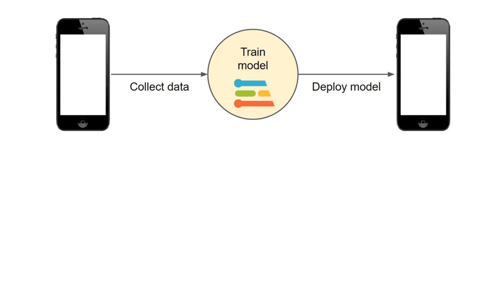

*Figura E1-S1 — O mesmo dispositivo (aqui, o celular) coleta os dados e, depois, executa o modelo treinado na nuvem. É o que você fará na Parte C.*

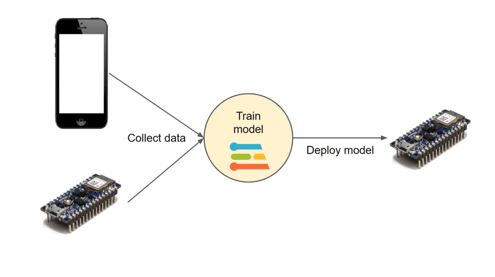

*Figura E1-S2 — Os dados podem vir de dispositivos diferentes (celular e placa com sensor), e o modelo é implantado num dispositivo embarcado. No nosso projeto, o ESP32 é o sensor, e o PC e o Raspberry Pi recebem o modelo.*

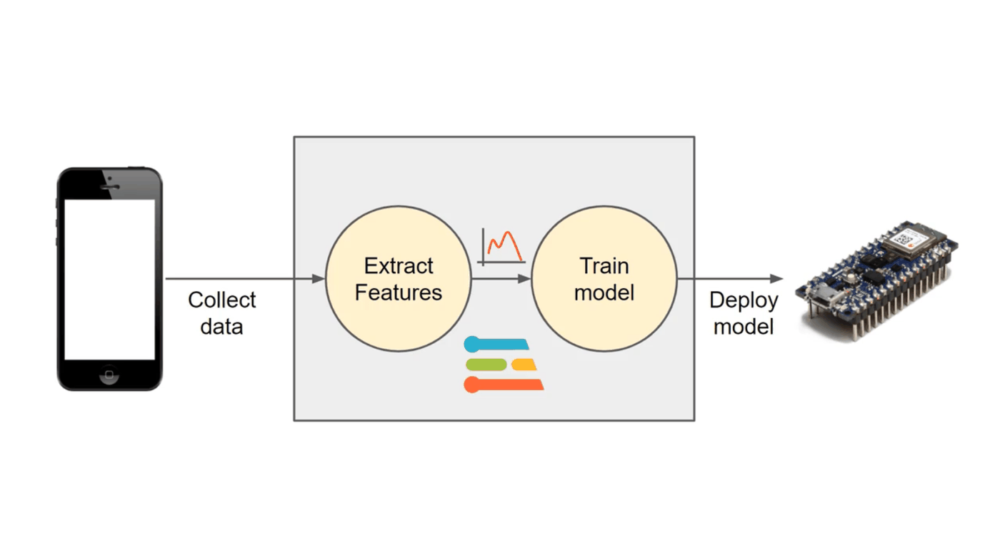

*Figura E1-S3 — O que existe dentro de _treinar_: primeiro **extraímos _features_**, depois **treinamos** o modelo. As duas partes vão juntas para o dispositivo — no nosso caso, dentro do arquivo `.eim`.*

### A.3 O ciclo de vida de um projeto de ML

```
 1. COLETA          2. FEATURES           3. TREINO          4. AVALIAÇÃO        5. IMPLANTAÇÃO
 sensor → dados  →  janela + DSP     →   rede neural    →   dados de TESTE  →   modelo na borda
 rotulados          (espectro, RMS)       aprende pesos      matriz de confusão   (.eim no PC/RPi)
        ↑_____________________________________________________________|
                 (resultado ruim? quase sempre a solução é voltar à COLETA)
```

Os passos 2 a 5 você fará com cliques no Studio; o passo 1, com o seu firmware (Etapa 2); o
passo 5, com os seus scripts (Etapas 3 e 4). Na prática, **a qualidade dos dados decide mais que
a escolha do algoritmo**.

Os slides mostram o mesmo ciclo como uma fila de oito setas. Acompanhe em que ponto dela entra cada assunto desta Parte A:

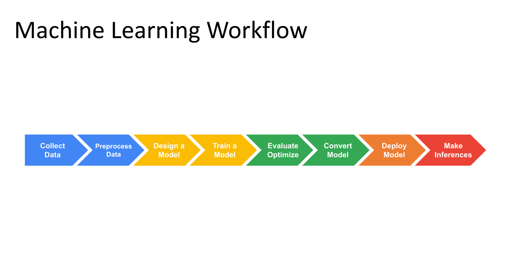

*Figura E1-S4 — O fluxo completo, da coleta (_Collect Data_) à inferência (_Make Inferences_).*

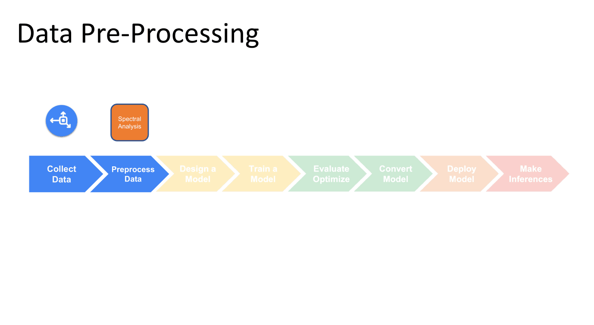

*Figura E1-S5 — **Pré-processar** os dados: o bloco de **análise espectral** (_Spectral Analysis_) — seção A.5.*

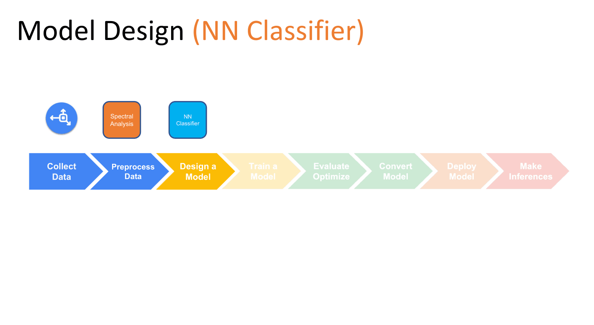

*Figura E1-S6 — **Projetar o modelo**: o **classificador por rede neural** (_NN Classifier_) — seção A.6.*

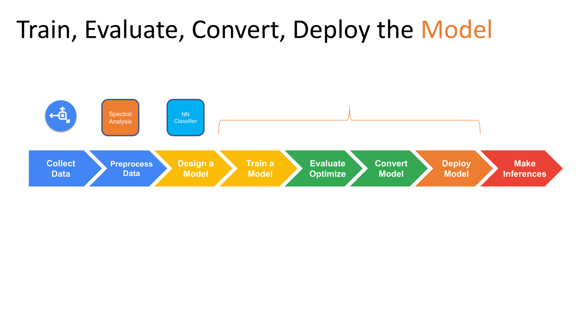

*Figura E1-S7 — **Treinar, avaliar, converter e implantar** — seções A.6 e A.7 e, na prática, as Etapas 2, 3 e 4.*

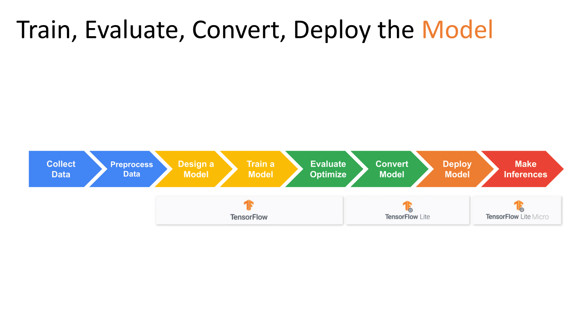

*Figura E1-S8 — As ferramentas por trás de cada fase: TensorFlow (treino e avaliação), TensorFlow Lite (conversão) e TensorFlow Lite Micro (microcontroladores). O Edge Impulse faz tudo isso por você; para Linux, o resultado é o `.eim`.*

### A.4 Série temporal e janela

O acelerômetro entrega uma **série temporal**: 62,5 amostras por segundo, cada uma com 3 valores
(`accX, accY, accZ`). Uma única amostra não diz nada sobre movimento (um instante de `lift` pode
ser idêntico a um instante de `idle`). O modelo precisa olhar um **trecho** — uma **janela**.

A sequência a seguir mostra, passo a passo, **por que** precisamos de uma janela:

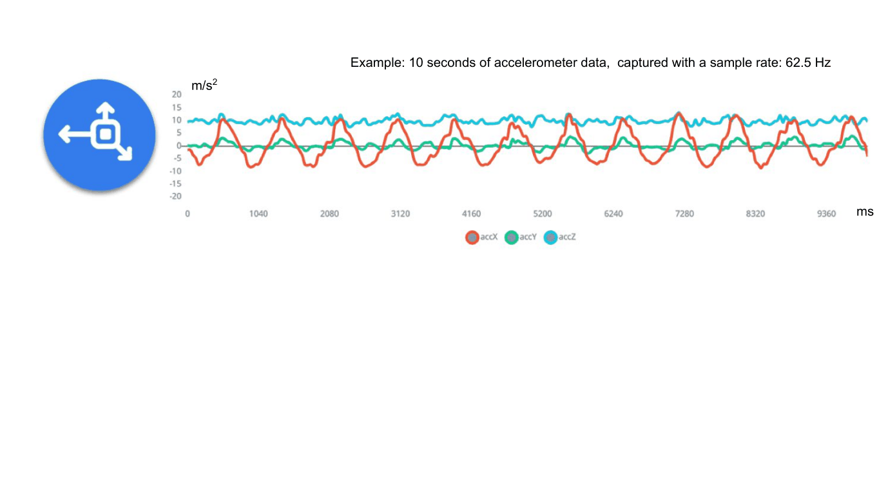

*Figura E1-S9 — 10 s de acelerômetro a 62,5 Hz durante um movimento contínuo: `accX` (vermelho), `accY` (verde) e `accZ` (azul). Note `accZ` ≈ 10 m/s²: é a gravidade.*

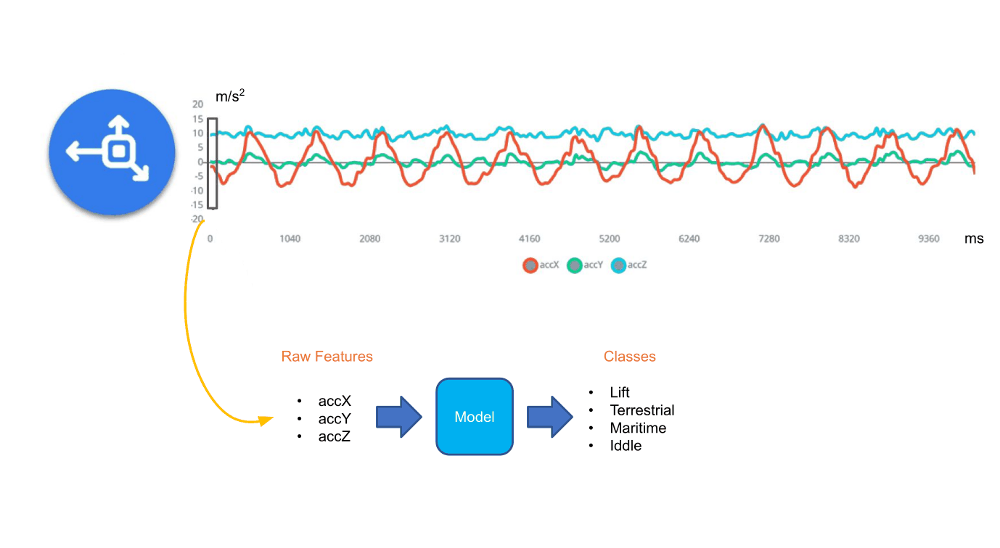

*Figura E1-S10 — Primeira ideia: usar como entrada do modelo só os 3 valores de **um instante** (`accX, accY, accZ`).*

![Um instante vira um vetor de 3 números, e o modelo devolveria uma classe (codificação one-hot: [1, 0, 0, 0] = primeira classe).](https://raw.githubusercontent.com/fabiobento/sis-emb-2026-2/main/assets/figuras/imu_amostra_unica_vetor.png)

*Figura E1-S11 — Um instante vira um vetor de 3 números, e o modelo devolveria uma classe (codificação _one-hot_: `[1, 0, 0, 0]` = primeira classe).*

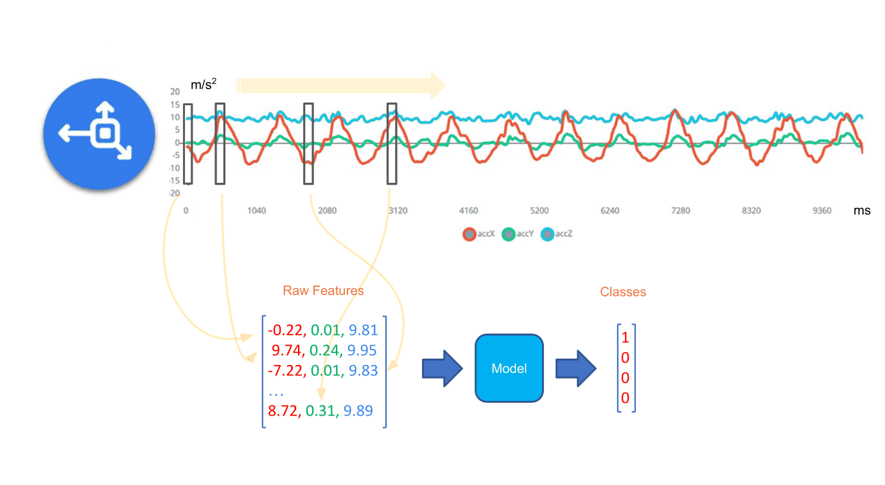

*Figura E1-S12 — Mas instantes diferentes do **mesmo** movimento dão vetores muito diferentes (em X: −0,22, depois 9,74, depois −7,22…)…*

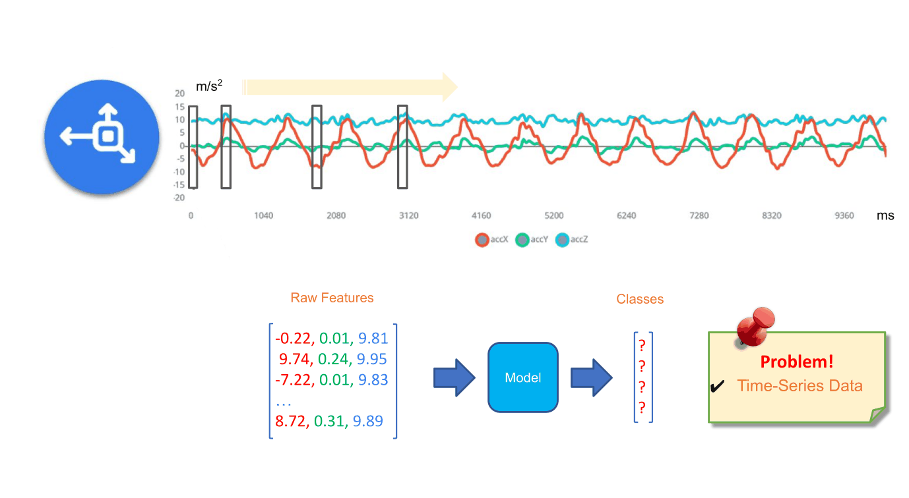

*Figura E1-S13 — …e, amostra por amostra, o modelo não tem como decidir. **O problema é que o dado é uma série temporal**: a informação está na variação ao longo do tempo.*

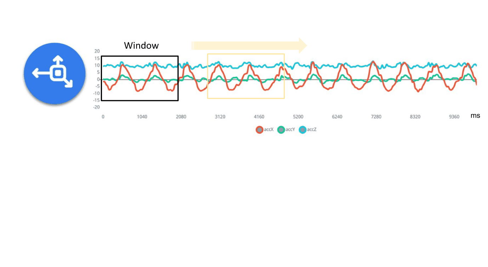

*Figura E1-S14 — A solução: olhar uma **janela** de tempo, que desliza sobre o sinal.*

- **Tamanho da janela** (*window size*): **2000 ms**. A 62,5 Hz são **125 amostras × 3 eixos =
  375 números**.
- **Incremento** (*window increase*): de quanto em quanto a janela "anda" ao fatiar os dados de
  treino. Com **80 ms**, janelas vizinhas se sobrepõem em 96 % — uma gravação vira muitas janelas.

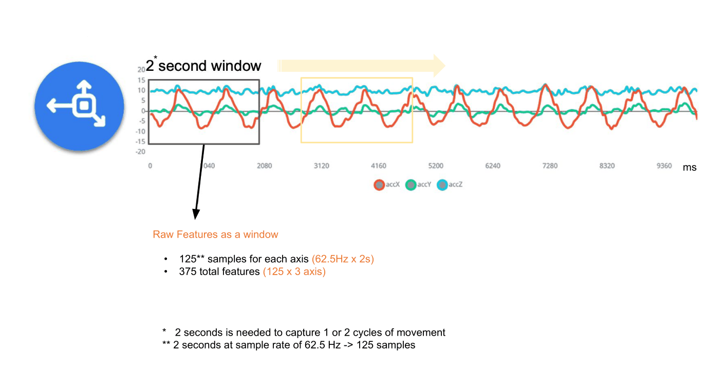

*Figura E1-S15 — A janela de 2 s em números: 62,5 Hz × 2 s = **125 amostras por eixo**; 125 × 3 eixos = **375 _raw features_**. Dois segundos bastam para conter 1 ou 2 ciclos do movimento.*

> **Exemplo resolvido 1.1 — quantas janelas uma gravação gera?** Uma amostra de 10 s, janela de
> 2 s e incremento de 80 ms: a primeira janela começa em 0 s e a última começa em 8 s.
> Número de janelas = (10 000 − 2 000) / 80 + 1 = **101 janelas**. Doze gravações de 10 s por
> classe ⇒ ~1 200 janelas por classe para treinar. (Por isso 2 minutos de dados já bastam.)

O porquê dos 62,5 Hz é o **teorema da amostragem** da semana 7: para representar um sinal sem
*aliasing*, `fs > 2 × f_max`. Movimentos humanos têm energia útil abaixo de ~10–15 Hz; a 62,5 Hz o
limite de Nyquist é **31,25 Hz** — folga confortável. E o filtro interno do MPU-6050 (≈ 21 Hz) faz
o papel do **filtro anti-*aliasing*** (semana 7, seção 3.4).

### A.5 *Features*: o bloco de processamento de sinal (DSP)

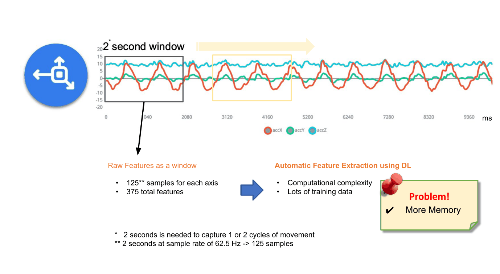

*Figura E1-S16 — Por que não entregar os 375 números direto a uma rede profunda, que extrairia as _features_ sozinha? Funciona, mas exige mais computação, mais dados de treino e **mais memória** — ruim para um sistema embarcado. Por isso extraímos as _features_ "à mão", com processamento de sinais.*

Entregar os 375 números crus a uma rede é possível, mas desperdiça dados e treino. O Edge Impulse
usa um bloco de **análise espectral** (*Spectral Analysis*) que **resume** cada janela em algumas
dezenas de números — as *features* — calculados **para cada eixo**:

| *Feature* | O que mede | Intuição |
|---|---|---|
| **RMS** | "energia" do sinal no tempo | `idle` ≈ 0; `terrestrial` alto no X |
| Assimetria (*skewness*) e curtose | o formato da distribuição dos valores | trancos × ondulação suave |
| **Potência espectral por faixa** (via **FFT**) | quanta energia há em cada faixa de frequência | `maritime` concentra energia < 1 Hz; `terrestrial`, em 1–3 Hz |

Antes disso, o bloco aplica um **filtro** (passa-baixas ou passa-altas, configurável) para remover
ruído ou a componente contínua (a gravidade!).

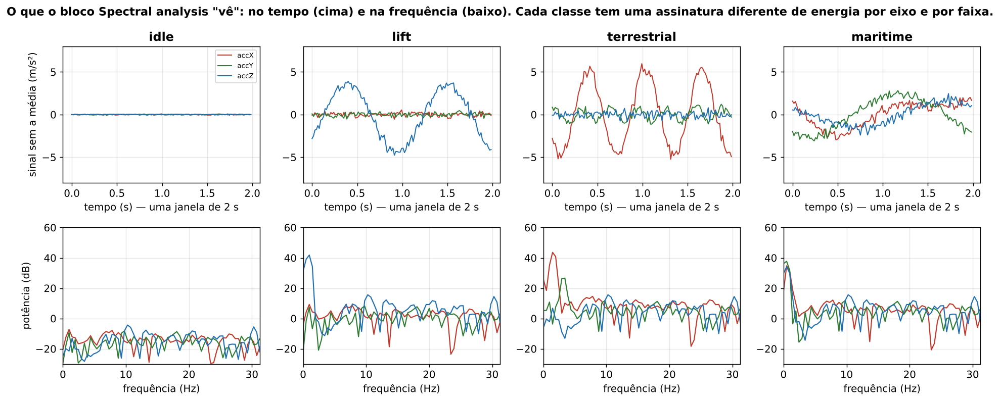

*Figura E1-A — O que o bloco espectral "vê". Cada classe tem uma assinatura: qual eixo tem
energia e em que frequência. Essa é a informação que a rede vai usar.*

**Resolução em frequência.** A FFT de N pontos com taxa `fs` separa frequências espaçadas de
`Δf = fs / N`. Com `fs = 62,5 Hz` e FFT de 64 pontos, `Δf ≈ 0,98 Hz`; com 128 pontos, ≈ 0,49 Hz.
Movimentos lentos (`maritime`, ~0,5 Hz) pedem FFT maior — e, portanto, **janela longa** (2 s ou
mais). É a mesma troca da semana 7: ver detalhes em frequência exige observar por mais tempo.

Os slides montam as *features* do bloco espectral **passo a passo**. Siga a sequência:

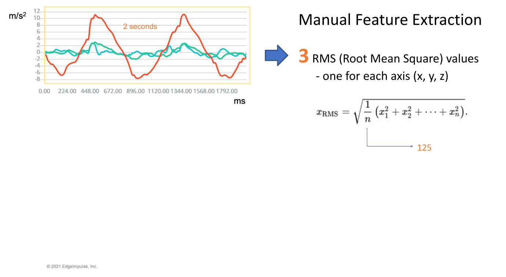

*Figura E1-S17 — Passo 1 — **RMS** de cada eixo na janela de 2 s (n = 125 amostras): 3 _features_, uma por eixo. Mede a "energia" do movimento.*

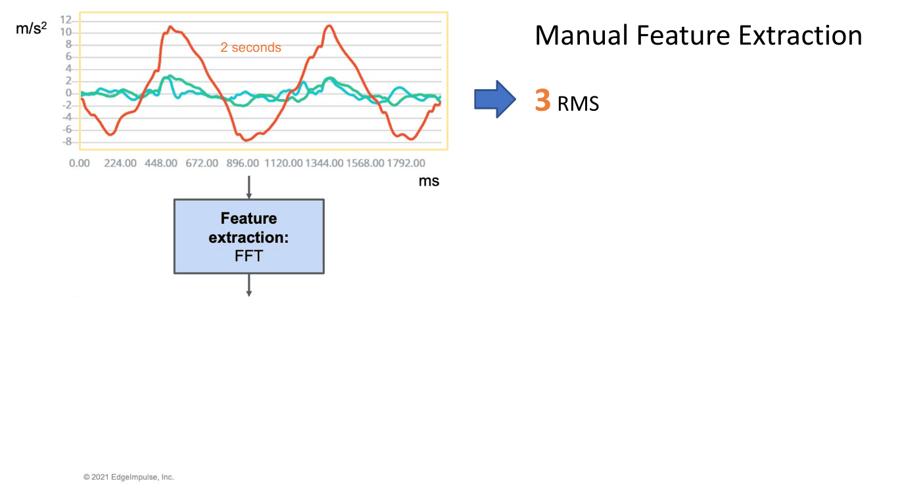

*Figura E1-S18 — Passo 2 — além do RMS, a janela passa pela **FFT**, para vermos o sinal no domínio da frequência.*

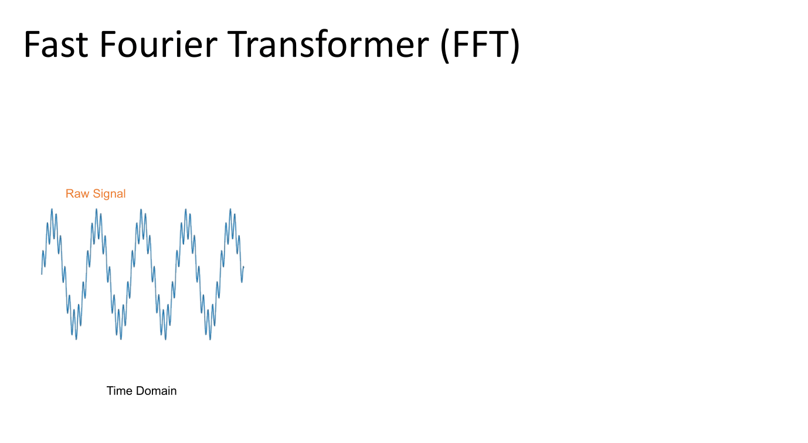

*Figura E1-S19 — O que a FFT faz (1/3): um sinal bruto no tempo, aparentemente complicado…*

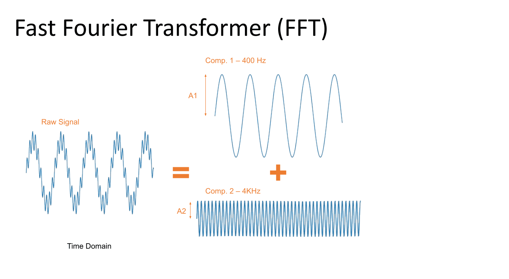

*Figura E1-S20 — (2/3) …é a soma de senoides simples — aqui, uma de 400 Hz (amplitude A1) e outra de 4 kHz (amplitude A2)…*

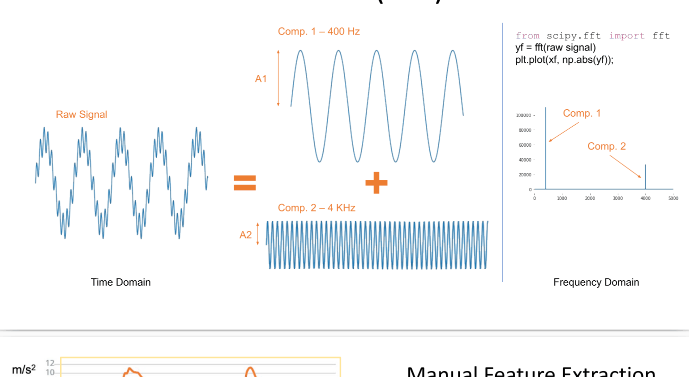

*Figura E1-S21 — (3/3) …e a FFT mostra cada componente como um **pico** no domínio da frequência: a posição é a frequência e a altura é proporcional à amplitude (à direita, o código em Python com `scipy.fft`).*

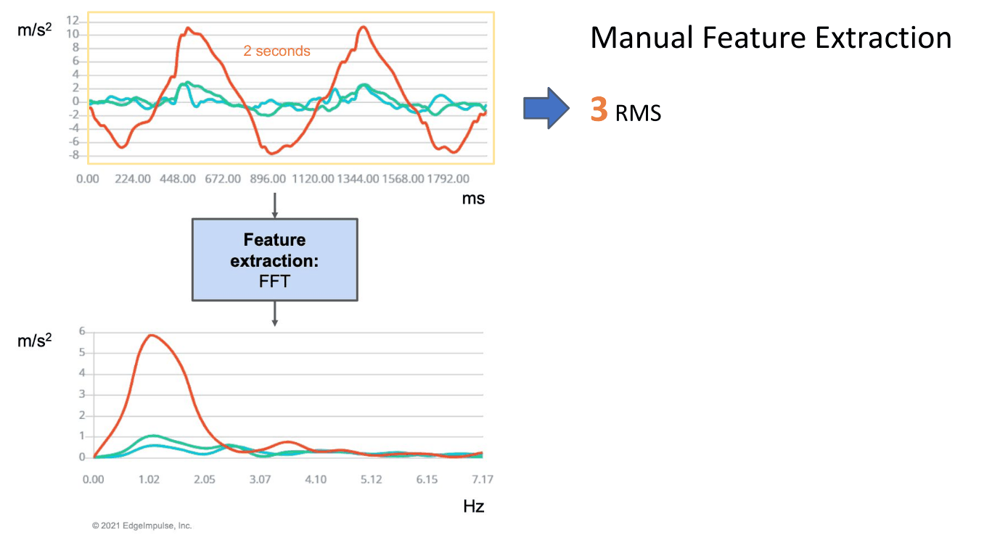

*Figura E1-S22 — A FFT aplicada à janela do acelerômetro: a energia do movimento concentra-se perto de 1 Hz no eixo X (vermelho).*

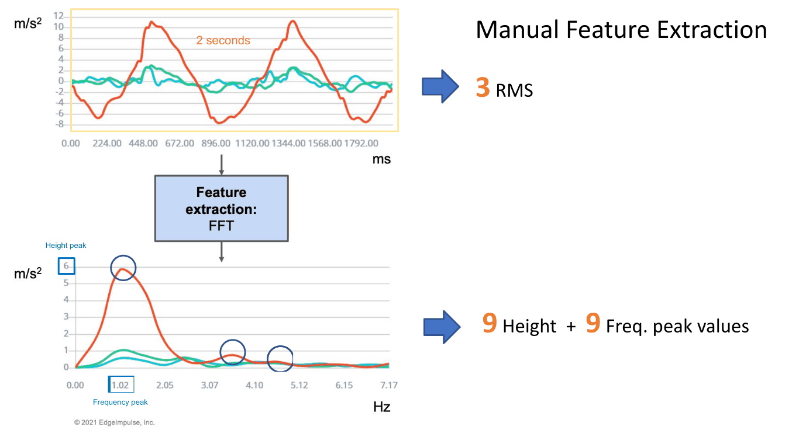

*Figura E1-S23 — Passo 3 — de cada espectro tiramos os 3 maiores **picos**, com altura (_height_) e frequência: 9 alturas + 9 frequências.*

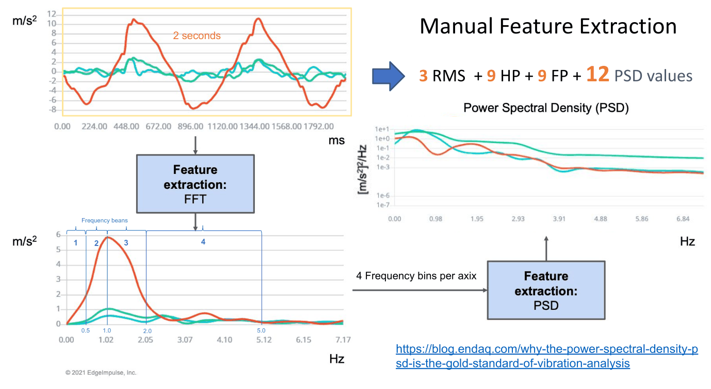

*Figura E1-S24 — Passo 4 — a **densidade espectral de potência** (PSD) somada em 4 faixas de frequência (_bins_) por eixo: 12 _features_.*

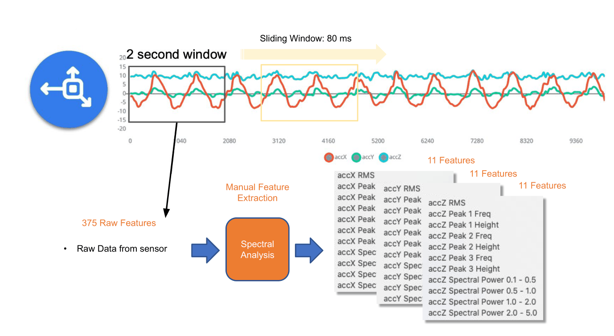

*Figura E1-S25 — Resultado: os 375 números crus viram **33 _features_** (11 por eixo: RMS, 3 picos × altura/frequência e 4 faixas de potência). Os números do seu projeto podem ser outros, porque o bloco do Studio é configurável; confira e anote na Q2.*

### A.6 O classificador: uma pequena rede neural

Um **neurônio artificial** faz uma conta que você conhece: soma ponderada + uma não-linearidade.

```
y = ativação( w1·x1 + w2·x2 + … + wn·xn + b )          (ReLU: ativação(s) = max(0, s))
```

Os **pesos** `w` e o **viés** `b` começam aleatórios. Uma **rede densa** empilha camadas desses
neurônios. A do projeto de referência é:

```
features (dezenas)  →  camada de 20 neurônios  →  camada de 10  →  4 saídas (uma por classe)
```

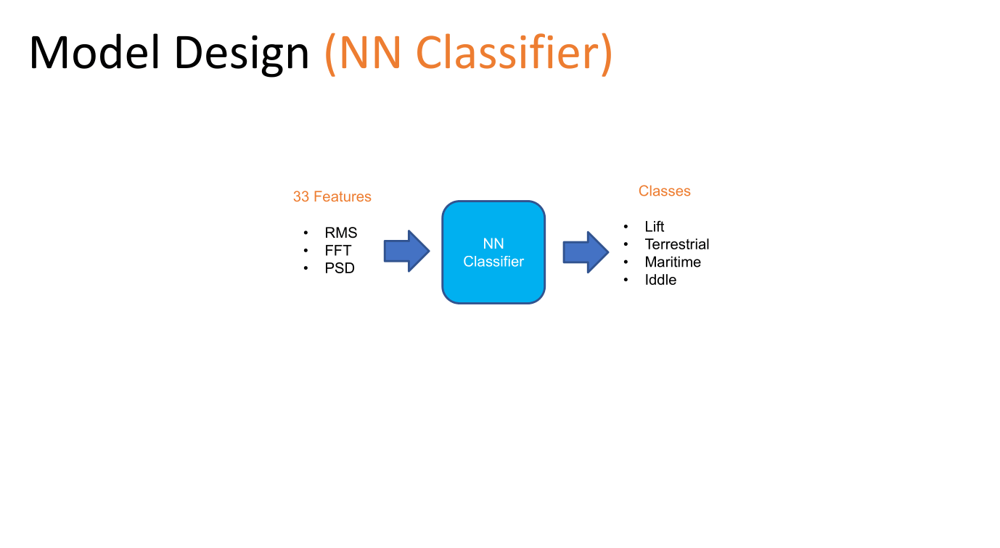

*Figura E1-S26 — O classificador visto de fora: entram as 33 _features_ e saem as 4 classes.*

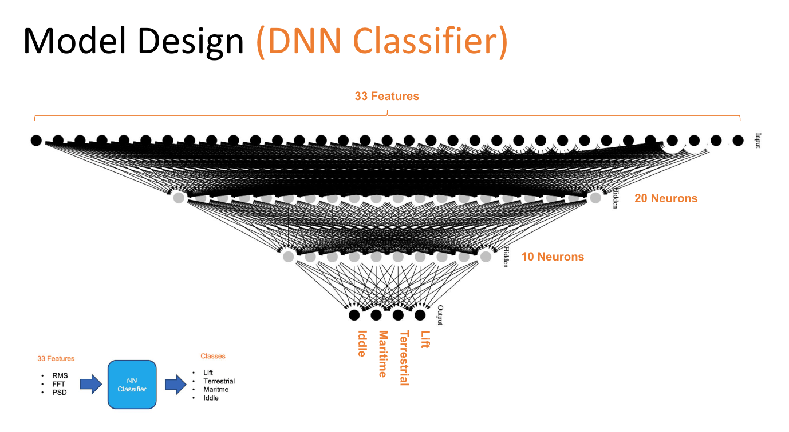

*Figura E1-S27 — Por dentro: 33 entradas → 20 neurônios → 10 neurônios → 4 saídas. Cada ligação tem um peso ajustável (rede **densa**).*

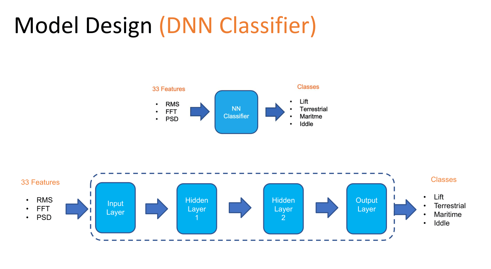

*Figura E1-S28 — As mesmas camadas desenhadas como blocos: entrada, duas camadas ocultas e camada de saída.*

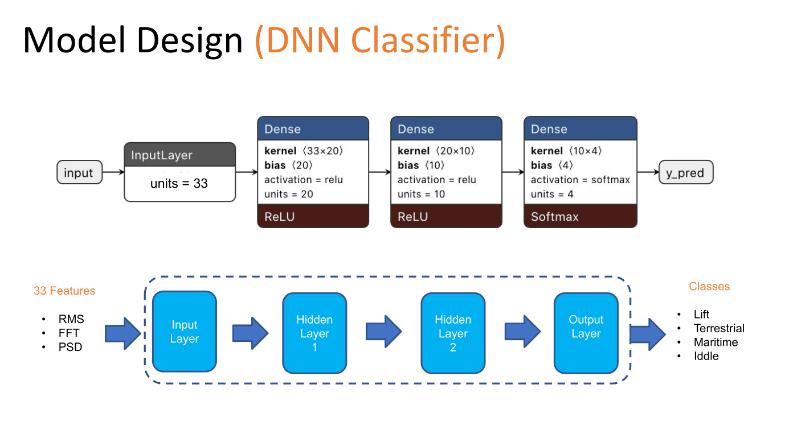

*Figura E1-S29 — A rede como o Edge Impulse a descreve (Keras): camadas `Dense` 33×20 e 20×10 com ReLU e 10×4 com **softmax** na saída.*

A última camada usa **softmax**, que transforma 4 números quaisquer em 4 **probabilidades** que
somam 1:

> **Exemplo resolvido 1.2 — softmax.** Saídas "cruas" da rede para `[idle, lift, maritime,
> terrestrial]` = `[2,0; 0,5; 4,1; 0,3]`. Exponenciais: `e^2,0 = 7,39`, `e^0,5 = 1,65`,
> `e^4,1 = 60,34`, `e^0,3 = 1,35`; soma = 70,73. Probabilidades: `7,39/70,73 = 0,10`,
> `0,02`, **`0,85`**, `0,02`. Resposta: **`maritime` com 85 % de confiança**.

**Treinar** é repetir, muitas vezes, três passos: (1) a rede classifica as janelas de treino;
(2) mede-se o erro em relação aos rótulos; (3) cada peso é ajustado um pouquinho na direção que
reduz o erro. Uma passada completa por todos os dados é um **ciclo de treino** (*epoch*). O
tamanho de cada ajuste é a **taxa de aprendizado** (*learning rate*).

### A.7 Avaliação: treino, validação, teste, *overfitting*

| Conjunto | Para quê | Quem separa |
|---|---|---|
| **Treino** | ajustar os pesos | você (aba *Training*) |
| **Validação** | acompanhar o treino a cada ciclo (≈ 20 % do treino) | o Studio, automaticamente |
| **Teste** | medir **de verdade**, com dados que o modelo **nunca viu** | você (aba *Test*) |

- ***Underfitting*** (subajuste): o modelo é simples demais ou treinou pouco — erra até no treino.
- ***Overfitting*** (sobreajuste): o modelo "decorou" o treino — acerta 100 % lá e erra no mundo
  real. Sintoma: acurácia de treino/validação muito maior que a de teste.

A sequência mostra como os dados coletados são divididos:

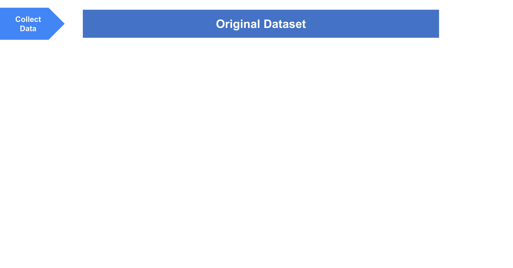

*Figura E1-S30 — Parte-se do conjunto original de dados (todas as gravações).*

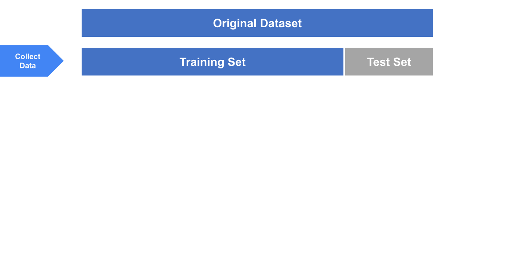

*Figura E1-S31 — Primeiro, separa-se um **conjunto de teste**, que o treino nunca verá.*

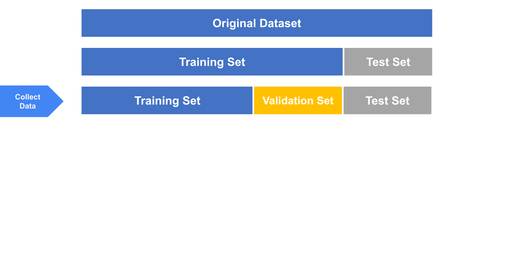

*Figura E1-S32 — Do que sobrou, separa-se a **validação** (o Studio faz isso automaticamente, ≈ 20 %).*

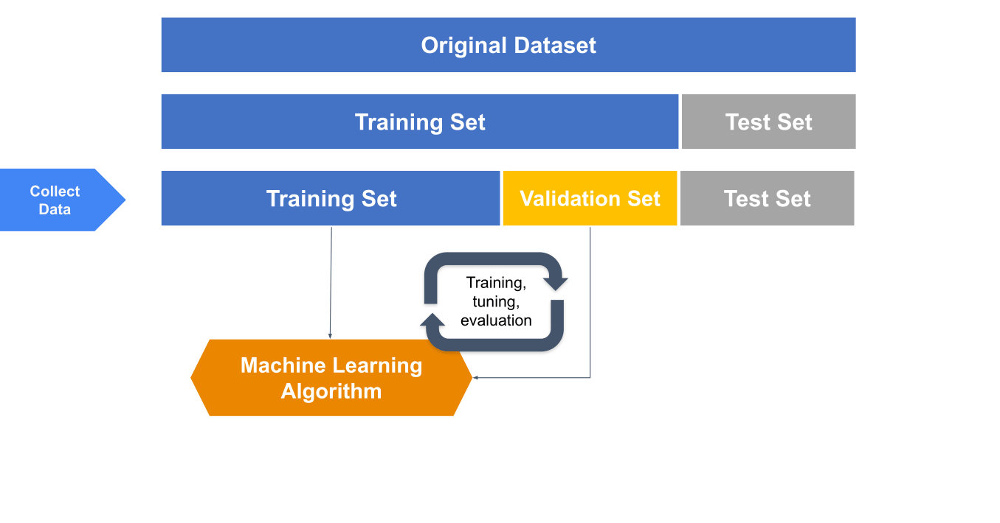

*Figura E1-S33 — Treino e validação alimentam o ciclo de treino, ajuste e avaliação do algoritmo.*

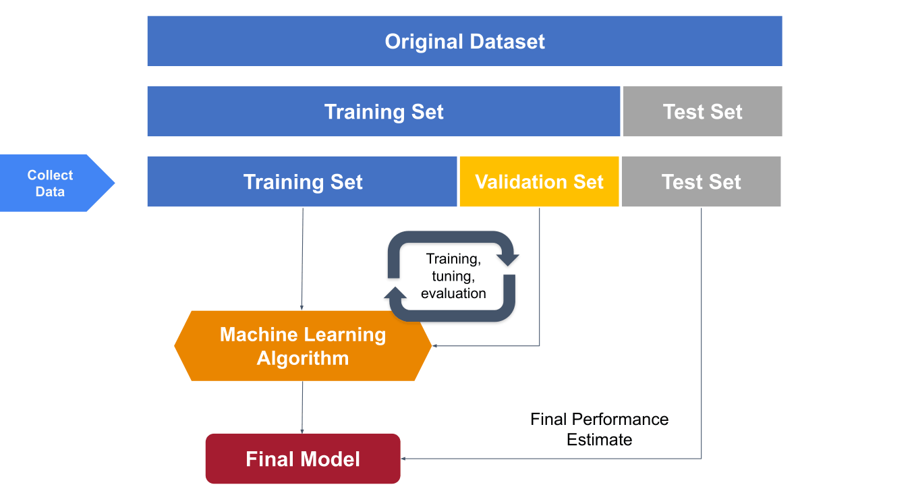

*Figura E1-S34 — Só no fim, o **teste** dá a estimativa final de desempenho do modelo final.*

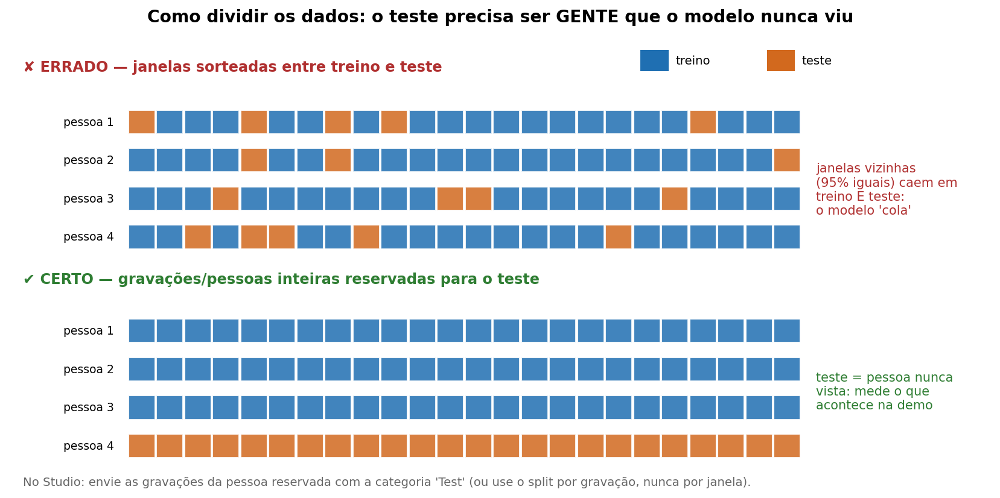

*Figura E1-B — Como as janelas vizinhas são quase iguais, o teste precisa ser feito com
**gravações inteiras** (de preferência de outra pessoa) que não entraram no treino.*

A **matriz de confusão** mostra, para cada classe real (linha), como o modelo a classificou
(coluna). A diagonal são os acertos; fora dela, **quem se confunde com quem** — e isso diz o que
coletar a mais.

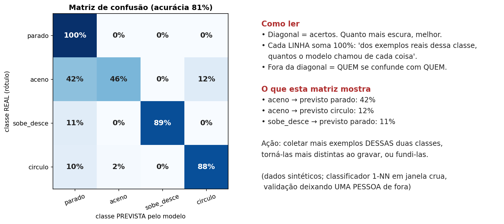

*Figura E1-C — Exemplo de leitura de uma matriz de confusão (outro projeto da apostila, com
outras classes; o raciocínio é o mesmo).*

> **Exemplo resolvido 1.3 — acurácia.** No teste, 40 janelas de cada classe (160 no total). O
> modelo acertou 40 `idle`, 38 `lift`, 33 `maritime` e 37 `terrestrial`. Acurácia =
> (40+38+33+37)/160 = **92,5 %**. Se 6 das 7 janelas de `maritime` erradas foram chamadas de
> `terrestrial`, a ação é: gravar mais `maritime` deixando a ondulação **mais lenta e em todos os
> eixos**, para diferenciá-la do vai-e-vem.

### A.8 Detecção de anomalias

A rede **sempre** responde uma das 4 classes — mesmo se você chacoalhar a placa de um jeito
nunca visto. Para perceber "isso não se parece com nada do treino", acrescentamos um segundo
bloco: **detecção de anomalias por K-means**. Ele agrupa as *features* de treino em *clusters*
(nuvens de pontos); na inferência, mede a **distância** da janela nova ao *cluster* mais próximo.
Distância grande ⇒ **escore de anomalia alto** ⇒ não confie na classe.

### A.9 O "impulso" do Edge Impulse

O Edge Impulse chama de **impulso** (*impulse*) a cadeia completa: janela → DSP → aprendizado.

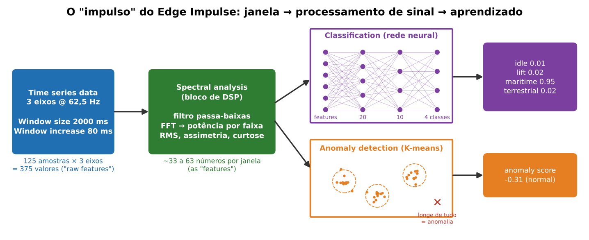

*Figura E1-D — O impulso do projeto de referência. Tudo isso é empacotado no arquivo `.eim` que
você vai rodar nas Etapas 3 e 4.*

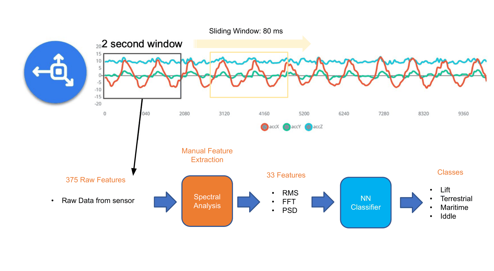

*Figura E1-S35 — O impulso na versão dos slides: 375 _raw features_ → análise espectral → 33 _features_ → classificador → 4 classes. Os slides não mostram o bloco K-means de anomalias, que o projeto de referência também tem.*

> 📝 **Relatório (Etapa 1, Q1):** em suas palavras, explique por que uma única amostra
> `accX,accY,accZ` não basta para reconhecer o movimento e por que precisamos de uma janela de
> 2 s (e não de 0,2 s) para distinguir `maritime`.

---

## Parte B — Conta no Edge Impulse e o projeto de referência (20 min)

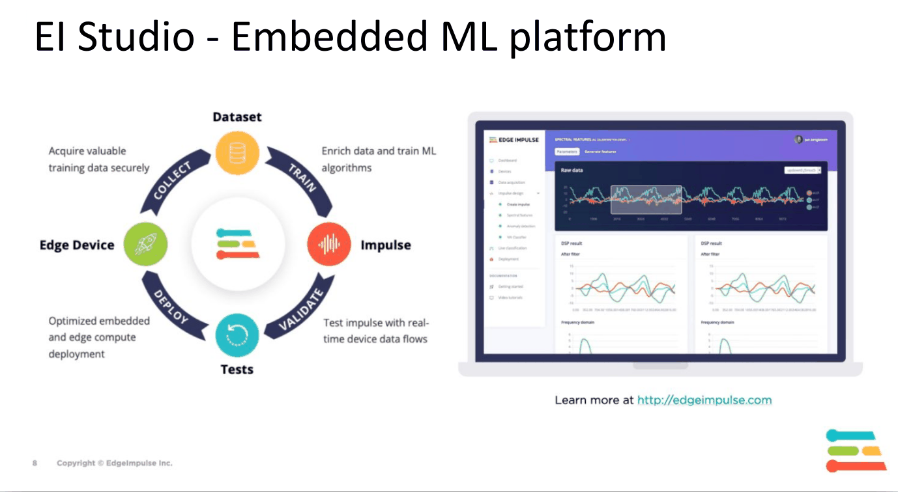

*Figura E1-S36 — O Edge Impulse Studio, a plataforma de ML embarcado que vamos usar: coletar → treinar → validar → implantar, em ciclo.*

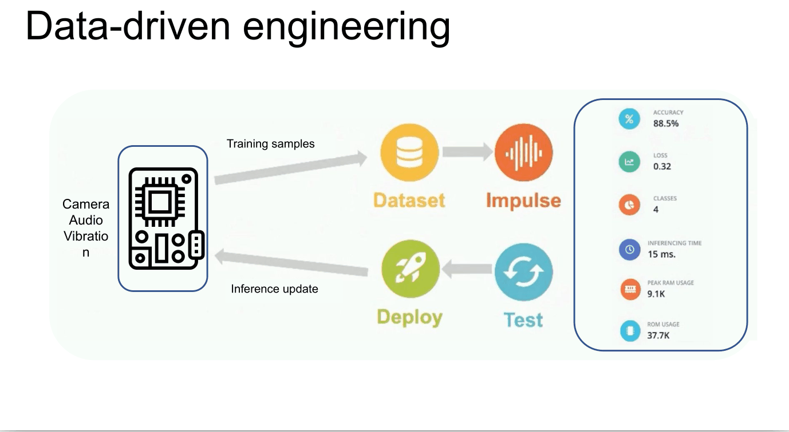

*Figura E1-S37 — Engenharia orientada por dados: amostras do dispositivo alimentam o _dataset_ e o impulso; depois do teste, o modelo volta ao dispositivo, com estimativas de acurácia, latência e uso de RAM e ROM.*

1. Crie sua conta gratuita em <https://edgeimpulse.com/signup> (use o e-mail institucional).
2. Abra o projeto de referência: <https://studio.edgeimpulse.com/public/509253/live>.
3. Clique em **Clone this project** (canto superior direito) e confirme. Em alguns instantes você
   terá uma **cópia completa** — dados, impulso e modelo — na sua conta.
4. Faça um "tour" pela cópia, pelo menu da esquerda, e **anote** no relatório o que encontrar:

| Menu | O que observar no projeto de referência |
|---|---|
| **Dashboard** | número de amostras, *project ID* |
| **Data acquisition** | as 4 classes, a duração das amostras (10 s), a divisão *Training/Test* |
| **Impulse design → Create impulse** | *Window size* 2000 ms, *Window increase* 80 ms, frequência 62,5 Hz, os blocos |
| **Spectral features** | os parâmetros do filtro e da FFT; os gráficos *After filter* e *Spectral power* |
| **Classifier** | a arquitetura da rede (camadas), número de ciclos, acurácia de validação |
| **Anomaly detection** | número de *clusters*, eixos (*features*) usados |
| **Model testing** | a acurácia de teste (≈ 96 %) e a matriz de confusão |

> 📝 **Relatório (Etapa 1, Q2):** copie para uma tabela os parâmetros do *Spectral features*
> (tipo de filtro, frequência de corte, ordem, tamanho da FFT etc.) e da rede neural do projeto de
> referência. Você vai usá-los como **ponto de partida** na Etapa 2.

---

## Parte C — Primeiro modelo com o celular (75 min)

Antes de montar o hardware, vamos fazer o ciclo completo usando o **acelerômetro do celular** —
assim você aprende o Studio sem depender de fios. As capturas de tela de cada passo estão nos
[slides "Reconhecimento de movimentos contínuos"](https://docs.google.com/presentation/d/1oIcHNPSVA_vh4FlVsO12M2JcFWncSQFJ/edit?usp=sharing&ouid=110939560925015610214&rtpof=true&sd=true)
(slides 4–70).

### C.1 Projeto novo e celular conectado (10 min) — slides 4–11

1. No Studio, crie um projeto **novo**: `celular-movimento-<seu nome>`.
2. Menu **Devices → Connect a new device → Use your mobile phone**. Aparece um **QR code**.
3. Aponte a câmera do celular para o QR code e abra o link. O celular aparece em *Devices* com a
   bolinha **verde** (conectado). Pelo menu "⋮" você pode renomeá-lo.

### C.2 Coleta (20 min) — slides 12–22

1. Menu **Data acquisition**. No painel *Collect data*, configure:
   - *Device*: o seu celular · *Sensor*: **Accelerometer** · *Frequency*: **62.5 Hz**
   - *Label*: `idle` · *Sample length (ms)*: **10000**
2. Clique em **Start sampling** e faça o movimento **continuamente** durante toda a gravação. Ao
   terminar, a amostra aparece na lista com 3 linhas coloridas (um eixo cada).
3. Grave **6 amostras de cada classe** (≈ 1 min por classe), segurando o celular como se fosse a
   "caixa":

| Label | Movimento com o celular |
|---|---|
| `idle` | celular parado sobre a mesa |
| `lift` | sobe e desce, vertical, ritmo de ~1 vez por segundo |
| `terrestrial` | vai-e-vem horizontal, sobre a mesa, numa linha reta |
| `maritime` | balanço lento, inclinando e ondulando em todas as direções, como um barco |

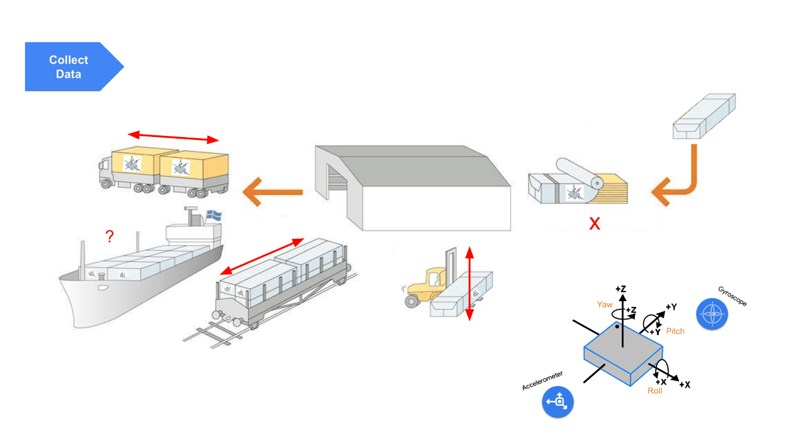

*Figura E1-S38 — Qual direção cada classe excita (setas vermelhas): `terrestrial`, vai-e-vem horizontal; `lift`, vertical; `idle`, nenhuma. Em `maritime` (o "?" no navio), todas ao mesmo tempo. No canto, os eixos do acelerômetro (lineares) e do giroscópio (rotações).*

   **Varie** um pouco a velocidade e a amplitude entre as gravações (o modelo precisa ver a
   variação que acontecerá no uso real).
4. Separe o teste: em **Dashboard → Perform train/test split** (ou movendo manualmente 1 amostra
   de cada classe para a aba **Test**, pelo menu "⋮" → *Move to test set*).

### C.3 O impulso (10 min) — slides 23–29

1. **Impulse design → Create impulse**:
   - *Time series data*: *Window size* **2000 ms**, *Window increase* **80 ms**, *Frequency* 62.5 Hz.
   - **Add a processing block → Spectral Analysis**.
   - **Add a learning block → Classification**.
   - **Save Impulse**.
2. **Spectral features**: comece pelos parâmetros que você anotou do projeto de referência (ou
   clique em **Autotune parameters**, quando disponível) → **Save parameters** → **Generate
   features**.
3. Observe o **Feature explorer**: cada ponto é uma janela; cores são classes. Se você enxerga
   grupos separados por cor, a rede também vai conseguir. Grupos misturados indicam classes que
   vão se confundir.

### C.4 Treino e o experimento dos ciclos (15 min) — slides 44–58

Em **Classifier**, mantenha a arquitetura padrão (20 e 10 neurônios) e faça o experimento:

| *Training cycles* | Acurácia de validação | Observação (qual classe acerta primeiro? por quê?) |
|---|---|---|
| 1 | | |
| 2 | | |
| 30 | | |

> 💡 Repare que `idle` costuma ser a primeira classe a acertar: suas *features* (RMS ≈ 0, sem
> pico no espectro) são **muito diferentes** das outras — ela fica isolada no *Feature explorer*.
> E desconfie de 100 %: com poucos dados, pode ser *overfitting*.

### C.5 Teste (10 min) — slides 59–69

1. **Model testing → Classify all**: anote a acurácia de **teste** e compare com a de validação.
2. **Live classification**: com o celular conectado, *Sample length* 10000 → **Start sampling** e
   faça um movimento. O Studio mostra a classe de cada janela.
3. **Anomalias**: volte a **Create impulse → Add a learning block → Anomaly Detection (K-means)**
   → **Save Impulse**. Em **Anomaly detection**, use **32 clusters** e **Select suggested axes** →
   **Start training**. Repita o *Live classification* fazendo um movimento **estranho** (girar o
   celular, sacudir rápido): o escore de anomalia deve subir.

> 📝 **Relatório (Etapa 1, Q3):** cole a tabela do experimento dos ciclos, a acurácia de teste e
> uma captura do *Live classification* (`evidencias/e1_live_celular.png`). Qual classe mais se
> confundiu, com qual, e o que você coletaria a mais para corrigir?

---

## Parte D — Ferramentas no PC e conferência do hardware (45 min)

### D.1 Sincronize o repositório

```bash
cd ~/sis-emb-2026-2 && git fetch && git reset --hard origin/main
```

### D.2 Instale as ferramentas (≈ 15 min, rode e siga para o D.3)

O script abaixo instala **Node.js 22**, a **Edge Impulse CLI** (que traz o
`edge-impulse-data-forwarder`), a **Edge Impulse Linux CLI** (que traz o
`edge-impulse-linux-runner`) e um ambiente Python `~/venv-ei` com o **SDK `edge_impulse_linux`**:

```bash
cd ~/sis-emb-2026-2/projeto-guiado-movimento/src/scripts
bash instalar_ferramentas_pc.sh
```

O que cada ferramenta faz no projeto:

| Ferramenta | Etapa | Função |
|---|---|---|
| `edge-impulse-data-forwarder` | 2 | ponte serial → Studio: lê as linhas `ax,ay,az` do ESP32 e as envia como amostras |
| `edge-impulse-linux-runner` | 3, 4 | baixa o modelo treinado como executável `.eim` para Linux |
| SDK Python `edge_impulse_linux` | 3, 4 | permite ao **seu** script Python mandar janelas ao `.eim` e receber a classe |
| `pyserial` | 3, 4 | leitura da porta serial no Python |

> ⚠️ **Por que uma *venv*?** No Ubuntu 24.04 (e no Raspberry Pi OS atual), `pip install` fora de
> um ambiente virtual dá o erro `externally-managed-environment` (regra PEP 668, que protege o
> Python do sistema). O script cria `~/venv-ei` com `--system-site-packages`, para enxergar os
> pacotes `numpy`, `pyserial`, `pyaudio` e `opencv` instalados pelo `apt`.
>
> ⚠️ **Por que `pyaudio` e `opencv` se não usamos áudio nem câmera?** Porque o SDK
> `edge_impulse_linux` importa seus módulos de áudio e de imagem assim que é carregado; sem eles,
> o `import` falha com `No module named 'pyaudio'` ou `Missing OpenCV`.

Quando terminar: **faça logout e login** (vale o grupo `dialout`, que dá acesso à porta serial
sem `sudo`) e confira:

```bash
edge-impulse-data-forwarder --version
edge-impulse-linux-runner --version
source ~/venv-ei/bin/activate
python -c "from edge_impulse_linux.runner import ImpulseRunner; print('SDK ok')"
groups | grep dialout
```

### D.3 Monte e confira o MPU-6050 (enquanto o script roda)

Monte a ligação do Lab 9, com o ESP32 **desligado da USB**:

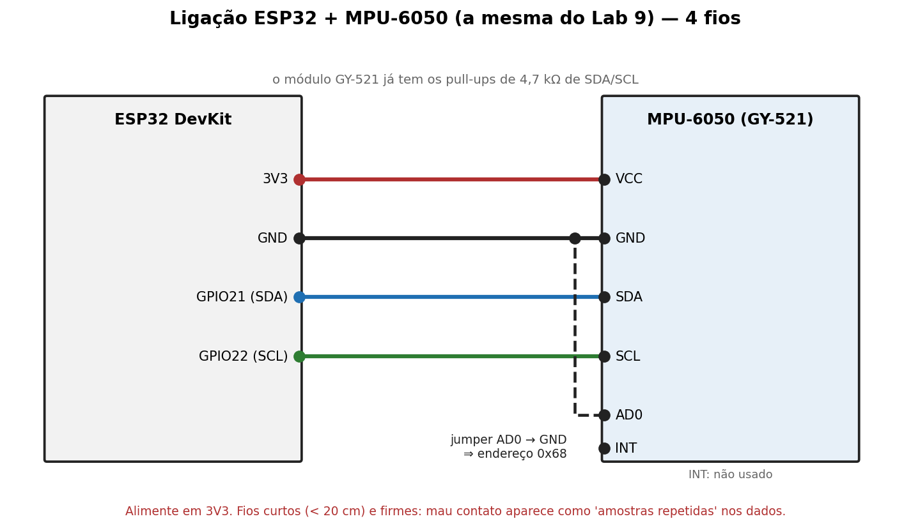

*Figura E1-E — A mesma ligação do Lab 9: 4 fios + AD0 em GND (endereço 0x68).*

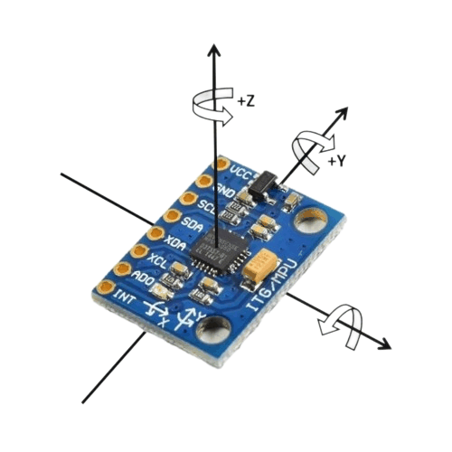

*Figura E1-S39 — Os eixos do MPU-6050 desenhados sobre o módulo GY-521: X e Y no plano da placa, Z perpendicular a ela. Com a placa deitada, a gravidade aparece em Z (≈ 9,8 m/s²).*

| ESP32 | MPU-6050 (GY-521) |
|---|---|
| 3V3 | VCC |
| GND | GND (e AD0) |
| GPIO21 | SDA |
| GPIO22 | SCL |

Grave o **scanner I²C** do Lab 9 e confirme que aparece o endereço `0x68`:

```bash
mkdir -p ~/sis-emb/projeto-guiado && cd ~/sis-emb/projeto-guiado
idf.py create-project i2c_scanner && cd i2c_scanner
cp ~/sis-emb-2026-2/semana-09/src/i2c_scanner/main.c main/i2c_scanner.c
idf.py set-target esp32 && idf.py -p /dev/ttyUSB0 flash monitor     # sai com Ctrl+]
```

> 💡 **Fixe o MPU-6050 na protoboard** (a protoboard será a "caixa" da carga) e **não mude mais
> essa montagem** até o fim do projeto. Se a orientação do sensor mudar entre a coleta (Etapa 2) e
> o uso (Etapas 3–4), o modelo verá "outra coisa" — é o contrato.

### ✅ Chegamos (fim do encontro 1)

- [ ] Projeto de referência clonado e explorado; parâmetros anotados.
- [ ] Modelo do celular treinado, testado e com anomalias.
- [ ] `edge-impulse-data-forwarder --version` e o `import` do SDK funcionando.
- [ ] Scanner I²C mostrando `0x68`.
- [ ] Commit: `projeto-guiado: etapa 1 — studio e ferramentas`.
