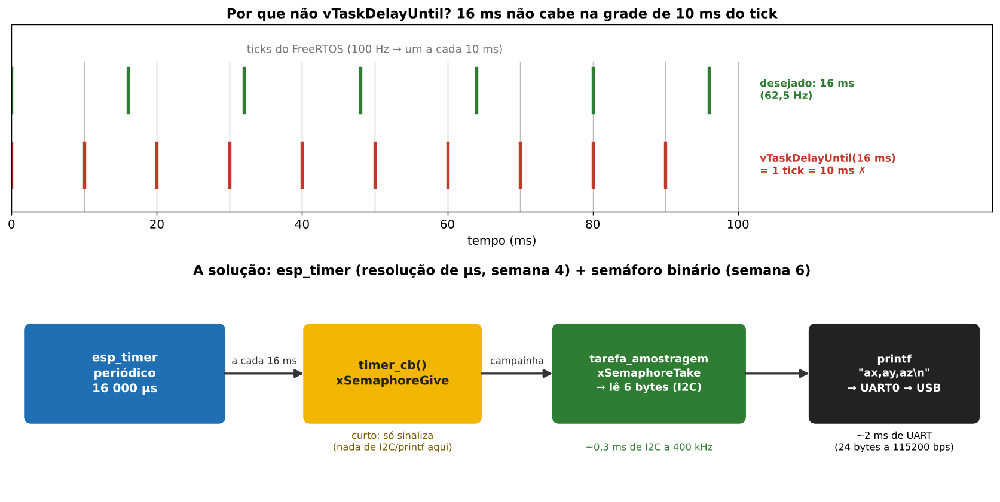

# Etapa 2 — Ingestão de dados: ESP32 → PC → Edge Impulse

**Encontro 2 (4 aulas = 200 min)** · [← Etapa 1](etapa-1-studio.md) · [visão geral](README-projeto-guiado.md) · [Etapa 3 →](etapa-3-inferencia-pc.md)

**Objetivos**

1. Escrever (entender linha a linha) o firmware que **serializa** o acelerômetro do MPU-6050 a
   uma taxa **cravada** de 62,5 Hz.
2. Usar o `edge-impulse-data-forwarder` como ponte **ESP32 → PC → Studio**.
3. Coletar um conjunto de dados próprio das 4 classes, com divisão treino/teste honesta.
4. Treinar, avaliar e testar ao vivo o modelo com **os seus** dados.

| Parte | Tempo | Conteúdo |
|---|---|---|
| A | 30 min | Teoria: serialização, protocolo do *data forwarder*, amostragem cravada |
| B | 40 min | Firmware `imu_serial`: compilar, gravar, conferir a taxa |
| C | 20 min | *Data forwarder*: conectar o ESP32 ao seu projeto |
| D | 45 min | Coleta das 4 classes (treino e teste) |
| E | 65 min | Impulso, *features*, treino, anomalias, teste e *live classification* |

> Pré-requisitos: Etapa 1 concluída (ferramentas instaladas, scanner I²C mostrando `0x68`, MPU-6050
> fixo na protoboard).

---

## Parte A — Teoria: do registrador à linha de texto (30 min)

### A.1 O caminho de uma amostra

```
MPU-6050 ──I²C 400 kHz──▶ ESP32 ──UART0 115200 bps──▶ chip USB-serial ──USB──▶ PC (/dev/ttyUSB0)
 (6 bytes)                 (converte e formata)           (CP2102/CH340)          (data forwarder
                                                                                    ou Python)
```

No **Lab 9** você leu o MPU-6050 por I²C (semana 9). A novidade aqui é o que fazemos **depois**
da leitura: transformar os números numa **linha de texto padronizada** que um programa no PC
consegue interpretar sem ambiguidade. Isso é **serialização**.

### A.2 O protocolo do *data forwarder*

O `edge-impulse-data-forwarder` é uma ponte genérica: ele lê a serial, descobre sozinho quantos
eixos e qual a taxa, e envia os dados ao seu projeto. Em troca, exige um protocolo simples:

1. **115200 bps**;
2. **uma leitura por linha**, terminada em `\n`;
3. valores separados por **vírgula** (ou TAB);
4. **nada além de números** — nenhum texto, unidade ou rótulo na linha.

```
-0.1197,0.0359,9.8259
-0.1245,0.0311,9.8163
-0.1149,0.0407,9.8307
```

> 💡 O *forwarder* trata linhas que começam com `ERR` como **mensagem de erro** e as mostra na
> tela. O nosso firmware usa isso: se o MPU-6050 não responder, ele imprime
> `ERR: MPU-6050 nao respondeu...` em vez de números — e você vê o problema direto no terminal.

> **Exemplo resolvido 2.1 — a UART aguenta?** Uma linha típica tem ~25 caracteres
> (`-12.3456,-3.2100,9.8066\n`). Na UART 8N1 cada caractere custa **10 bits** (start + 8 + stop).
> Por linha: 250 bits; a 62,5 Hz: 250 × 62,5 = **15 625 bit/s**, ou **13,6 %** de 115 200 bit/s.
> Cada linha leva 250 / 115 200 ≈ **2,2 ms** para sair — cabe com folga nos 16 ms entre amostras.
> (A 1 kHz não caberia: 250 000 bit/s > 115 200.)

### A.3 Do registrador ao m/s²

Os 6 bytes a partir do registrador `0x3B` são `AX_H, AX_L, AY_H, AY_L, AZ_H, AZ_L`, cada eixo um
inteiro de 16 bits em **complemento de 2**, *big-endian* (semana 9). A sensibilidade depende do
fundo de escala (`AFS_SEL`, registrador `0x1C`):

| `AFS_SEL` | Fundo de escala | Sensibilidade |
|---|---|---|
| 0 | ±2 g | 16 384 LSB/g |
| **1** | **±4 g** (nossa escolha) | **8 192 LSB/g** |
| 2 | ±8 g | 4 096 LSB/g |
| 3 | ±16 g | 2 048 LSB/g |

> **Exemplo resolvido 2.2 — conversão.** Com ±4 g, o eixo Z devolve os bytes `0x20 0x00`:
> `(0x20 << 8) | 0x00 = 8192` → `8192 / 8192 = 1,000 g` → `× 9,80665 = 9,807 m/s²` (a gravidade,
> sensor deitado). Se X devolver `0xF0 0x00`: como `int16`, vale `−4096` → `−0,5 g` → `−4,90 m/s²`.

**Por que ±4 g e não ±2 g?** Movimentos vigorosos de `terrestrial` passam facilmente de 1 g além
da gravidade; com ±2 g, o sinal **satura** (vira um patamar em ±19,6 m/s²) e o espectro fica
distorcido. **Por que m/s²?** É a unidade que o Edge Impulse usa para acelerômetros (o *forwarder*
marca eixos chamados `acc…` como `m/s2`) e a do projeto de referência.

**E o filtro?** O registrador `0x1A` (`CONFIG`, bits `DLPF_CFG`) liga um passa-baixas interno.
Com `DLPF_CFG = 4`, a banda do acelerômetro fica em ≈ 21 Hz — abaixo do limite de Nyquist de
31,25 Hz. É o **filtro anti-*aliasing*** da semana 7, já dentro do sensor.

### A.4 Amostragem cravada: por que `esp_timer` e não `vTaskDelayUntil`

Na semana 5 você cravou a taxa com `vTaskDelayUntil`. Aqui isso **não funciona**: o *tick* do
FreeRTOS no ESP-IDF é de **100 Hz** (resolução de 10 ms), e 16 ms não é múltiplo de 10 ms —
`pdMS_TO_TICKS(16)` vira **1 tick = 10 ms** (você amostraria a 100 Hz achando que é 62,5 Hz!).



*Figura E2-A — Em cima: o problema da resolução do tick. Embaixo: a solução com o `esp_timer`
(semana 4), que conta em microssegundos, e um semáforo binário (semana 6).*

A arquitetura usa duas ideias que você já domina:

- **`esp_timer` periódico de 16 000 µs** (semana 4): o "relógio" da amostragem. O *callback* roda
  numa tarefa de alta prioridade compartilhada; por isso ele deve ser **curto** (as mesmas regras
  das ISRs): **só sinaliza**.
- **Semáforo binário** (semana 6): o *callback* faz `xSemaphoreGive`; a nossa tarefa espera em
  `xSemaphoreTake` (dormindo, sem gastar CPU), lê o I²C e faz o `printf`.

> 📝 **Relatório (Etapa 2, Q1):** por que não colocar a leitura I²C e o `printf` direto dentro do
> *callback* do `esp_timer`? (Dica: semana 4, boas práticas de ISR; quanto tempo leva o `printf`
> segundo o Exemplo 2.1?)

---

## Parte B — Firmware `imu_serial` (40 min)

### B.1 Copie o projeto

O projeto ESP-IDF completo está em `src/imu_serial/` (inclui um `sdkconfig.defaults` que silencia
as mensagens de log do *boot*, para a serial carregar **só** dados):

```bash
cd ~/sis-emb/projeto-guiado
cp -r ~/sis-emb-2026-2/projeto-guiado-movimento/src/imu_serial .
cd imu_serial
ls -R
```

```
.:
CMakeLists.txt  main  sdkconfig.defaults

./main:
CMakeLists.txt  imu_serial.c
```

> 💡 Como `~/sis-emb/` é o diretório da bancada versionado no GitHub, evite subir os arquivos
> gerados pela compilação: `echo "build/" >> ~/sis-emb/.gitignore`.

### B.2 O código, parte por parte

Abra `main/imu_serial.c` no VS Code e acompanhe.

**(1) O contrato, em constantes.** Tudo o que precisa bater com o Studio está no topo:

```c
#define PIN_SDA         21          // mesma ligação do Lab 9
#define PIN_SCL         22
#define MPU_ADDR        0x68        // AD0 em GND
#define FS_HZ           62.5f       // taxa de amostragem (igual à do projeto de referência)
#define PERIODO_US      16000       // 1 / 62,5 Hz = 16 ms = 16 000 µs
#define MPU_RANGE       1           // AFS_SEL: 0:±2g 1:±4g 2:±8g 3:±16g
#define MPU_DLPF        4           // DLPF_CFG=4 → banda do acelerômetro ≈ 21 Hz
#define G_PARA_MS2      9.80665f    // 1 g em m/s²

#define LSB_POR_G       (16384.0f / (float)(1 << MPU_RANGE))   // 8192 para ±4 g
```

**(2) I²C — idêntico ao Lab 9.** `mpu_escreve` grava um registrador; `mpu_le` faz a leitura em
rajada com START repetido:

```c
static esp_err_t mpu_le(uint8_t reg, uint8_t *dst, size_t n)
{
    // escreve o endereço do registrador e, com START repetido, lê n bytes
    return i2c_master_write_read_device(I2C_NUM_0, MPU_ADDR, &reg, 1, dst, n,
                                        pdMS_TO_TICKS(50));
}
```

**(3) O *callback* do timer — só a campainha:**

```c
static void timer_cb(void *arg)
{
    xSemaphoreGive(s_sem_amostra);
}
```

**(4) A tarefa de amostragem — lê, converte, imprime:**

```c
static void tarefa_amostragem(void *arg)
{
    uint8_t b[6];
    float ult[3] = { 0.0f, 0.0f, G_PARA_MS2 };  // última amostra válida

    while (1) {
        xSemaphoreTake(s_sem_amostra, portMAX_DELAY);   // dorme até o timer tocar

        if (mpu_le(REG_ACCEL_XOUT, b, 6) == ESP_OK) {
            ult[0] = (int16_t)((b[0] << 8) | b[1]) / LSB_POR_G * G_PARA_MS2;
            ult[1] = (int16_t)((b[2] << 8) | b[3]) / LSB_POR_G * G_PARA_MS2;
            ult[2] = (int16_t)((b[4] << 8) | b[5]) / LSB_POR_G * G_PARA_MS2;
        }
        // se o I2C falhar, repete a última amostra: não "fura" a taxa
        printf("%.4f,%.4f,%.4f\n", ult[0], ult[1], ult[2]);
    }
}
```

> 💡 **Por que repetir a última amostra em caso de falha?** A FFT supõe **amostras igualmente
> espaçadas** (semana 7, seção 3.5). Uma amostra repetida distorce pouco; uma amostra **faltando**
> encolhe a janela no tempo e desloca todas as frequências.

**(5) `app_main` — identidade, configuração, sincronização, relógio:**

```c
void app_main(void)
{
    i2c_inicia();

    uint8_t who = 0;
    while (mpu_le(REG_WHO_AM_I, &who, 1) != ESP_OK || who != 0x68) {
        printf("ERR: MPU-6050 nao respondeu (WHO_AM_I=0x%02X). Confira a fiacao.\n", who);
        vTaskDelay(pdMS_TO_TICKS(1000));
    }

    mpu_escreve(REG_PWR_MGMT_1, 0x00);              // sai do modo SLEEP
    mpu_escreve(REG_CONFIG, MPU_DLPF);              // filtro passa-baixas interno
    mpu_escreve(REG_ACCEL_CFG, MPU_RANGE << 3);     // ±4 g
    vTaskDelay(pdMS_TO_TICKS(50));

    s_sem_amostra = xSemaphoreCreateBinary();
    xTaskCreate(tarefa_amostragem, "amostragem", 4096, NULL, 5, NULL);

    const esp_timer_create_args_t args = { .callback = timer_cb, .name = "amostra" };
    esp_timer_handle_t timer;
    ESP_ERROR_CHECK(esp_timer_create(&args, &timer));
    ESP_ERROR_CHECK(esp_timer_start_periodic(timer, PERIODO_US));
}
```

### B.3 Compile, grave e observe

```bash
cd ~/sis-emb/projeto-guiado/imu_serial
idf.py set-target esp32
idf.py build
idf.py -p /dev/ttyUSB0 flash monitor
```

Saída esperada no monitor (com o ESP32 parado sobre a mesa — Z perto de +9,8):

```
0.0479,-0.0718,9.8211
0.0431,-0.0766,9.8307
0.0527,-0.0670,9.8163
...
```

Mexa a protoboard e veja os números mudarem. Saia do monitor com **`Ctrl+]`** — **é obrigatório
fechar o monitor** antes dos próximos passos: só um programa por vez pode abrir a porta serial.

### B.4 Meça a taxa no PC

O script `01_leitor_serial.py` (Etapa 3, já pronto) lê a serial e imprime a **taxa medida** a
cada segundo:

```bash
source ~/venv-ei/bin/activate
cd ~/sis-emb-2026-2/projeto-guiado-movimento/src/python
python3 01_leitor_serial.py --porta /dev/ttyUSB0
```

```
Etapa 3-A: leitura básica da serial...
Porta serial '/dev/ttyUSB0' aberta com sucesso (115200 bps).
Recebido: 0.0479,-0.0718,9.8211
Recebido: 0.0431,-0.0766,9.8307
...
---- taxa medida: 62.5 linhas/s ----
```

(`Ctrl+C` encerra.) Se aparecer `Permission denied`, você não fez logout/login depois de entrar
no grupo `dialout` — veja o [guia de problemas](guia-problemas.md).

### B.5 Experimentos provocados (anote no relatório)

| # | Faça | Observe | Por quê? |
|---|---|---|---|
| 1 | Com o leitor rodando, **vire a protoboard de cabeça para baixo** | Z vai a ≈ −9,8 | a gravidade é medida em relação ao sensor |
| 2 | Deixe-a **de lado** (em pé) | a gravidade "passa" para X ou Y | é por isso que a montagem não pode mudar |
| 3 | Troque `PERIODO_US` para `10000`, regrave e meça | taxa ≈ 100 Hz | o contrato mudou: **volte para 16000** |
| 4 | Troque `MPU_RANGE` para `0` (±2 g) e sacuda forte | valores travam em ≈ ±19,6 | saturação — **volte para 1** |

> 📝 **Relatório (Etapa 2, Q2):** taxa medida (`linhas/s`) e os resultados dos 4 experimentos.

### B.6 (opcional) Veja o sensor em 3D

```bash
pip install pygame
python3 cubo3d.py --porta /dev/ttyUSB0
```

Um cubo gira conforme a inclinação calculada a partir da gravidade (feche a janela para sair).

---

## Parte C — *Data forwarder*: ESP32 → Studio (20 min)

### C.1 Crie o projeto da bancada

No Studio, crie um projeto **novo**: `movimento-bancada-N`. Em **Dashboard → Collaborators**,
adicione o colega de bancada (e o professor, se ele pedir).

### C.2 Ligue a ponte

Com o monitor **fechado**, rode no PC:

```bash
edge-impulse-data-forwarder --clean --frequency 62.5
```

- `--clean` apaga credenciais/projeto antigos e pergunta tudo de novo;
- `--frequency 62.5` fixa a taxa (em vez de "adivinhar" contando linhas durante 1 s, o que daria
  62 ou 63 Hz).

Responda às perguntas:

```
Edge Impulse data forwarder v1.40.x
? What is your user name or e-mail address (edgeimpulse.com)? seu.email@estudante.ifes.edu.br
? What is your password? [hidden]
Endpoints:
    Websocket: wss://remote-mgmt.edgeimpulse.com
    API:       https://studio.edgeimpulse.com
    Ingestion: https://ingestion.edgeimpulse.com

[SER] Connecting to /dev/ttyUSB0
[SER] Serial is connected (XX:XX:XX:XX:XX:XX)
[WS ] Connecting to wss://remote-mgmt.edgeimpulse.com
[WS ] Connected to wss://remote-mgmt.edgeimpulse.com
[SER] Detecting data frequency...
[SER] Overriding frequency to 62.5Hz (via --frequency)
? To which project do you want to connect this device? <seu usuário> / movimento-bancada-N
? 3 sensor axes detected (example values: [0.0479,-0.0718,9.8211]). What do you want to call them?
  Separate the names with ',': accX,accY,accZ
? What name do you want to give this device? esp32-bancada-N
[WS ] Device "esp32-bancada-N" is now connected to project "movimento-bancada-N".
[WS ] Go to https://studio.edgeimpulse.com/studio/XXXXXX/acquisition/training to build your machine learning model!
```

> ⚠️ **Os nomes dos eixos precisam ser exatamente `accX,accY,accZ`**, nessa ordem — é o contrato.
>
> 💡 Se aparecer `Failed to get info off device ... retrying in 5 seconds` uma vez, **espere**: ao
> abrir a porta, o ESP32 reinicia e as primeiras linhas do *boot* confundem a detecção; na segunda
> tentativa funciona. Se aparecer uma linha `ERR: MPU-6050 nao respondeu`, é fiação.
>
> 💡 **Sem digitar senha:** em **Dashboard → Keys** copie a *API key* do projeto (`ei_…`) e use
> `edge-impulse-data-forwarder --clean --frequency 62.5 --api-key ei_...`.

Deixe esse terminal **aberto** durante toda a coleta. Salve a saída em
`evidencias/e2_forwarder.txt`.

---

## Parte D — Coleta das 4 classes (45 min)

### D.1 O protocolo de coleta

No Studio, menu **Data acquisition**. No painel *Collect data*, o seu dispositivo
`esp32-bancada-N` aparece com o sensor *Sensor with 3 axes (accX, accY, accZ)* a **62.5 Hz**.

| Campo | Valor |
|---|---|
| *Label* | `idle`, `lift`, `terrestrial` ou `maritime` (sem acento, minúsculo) |
| *Sample length (ms)* | `10000` |
| *Frequency* | 62.5 Hz |

**Clique em *Start sampling* e só então comece o movimento — e mantenha-o contínuo até a barra
terminar.** A protoboard é a "caixa":

| Classe | Como mover a protoboard | Dica |
|---|---|---|
| `idle` | parada sobre a mesa (também: parada na mão, apoiada) | inclua pequenas variações de apoio |
| `lift` | sobe e desce na **vertical**, 20–30 cm, ~1 vez/s | sem inclinar |
| `terrestrial` | vai-e-vem **horizontal**, numa linha, deslizando sobre a mesa ou no ar | ritmo de 1–2 vezes/s, com trancos de "estrada" |
| `maritime` | balanço **lento** (~0,5 vez/s), inclinando e ondulando em todos os eixos | pense numa onda levantando a proa e depois a popa |

> ⚠️ **Mantenha a orientação de referência**: comece cada gravação com a protoboard deitada, fios
> do mesmo lado, como você vai usá-la nas Etapas 3 e 4.

### D.2 Quantidade e divisão treino/teste

| Conjunto | Quem grava | Quantidade por classe | Total |
|---|---|---|---|
| **Treino** (aba *Training*) | aluno 1 e aluno 2 alternando | **12 × 10 s** (≈ 2 min) | 48 amostras, 8 min |
| **Teste** (aba *Test*) | de preferência **outra pessoa** (colega de outra bancada) | **3 × 10 s** | 12 amostras, 2 min |

Para gravar direto no teste, selecione a aba **Test** no topo da *Data acquisition* antes de
clicar em *Start sampling* (ou mova depois pelo "⋮" → *Move to test set*). **Não** use divisão
automática por janela (Figura E1-B).

> **Exemplo resolvido 2.3 — quanto tempo isso leva?** 60 gravações × (10 s + ~10 s de
> preparação/envio) ≈ **20 min**. Por isso os papéis: um aluno movimenta, o outro opera o Studio e
> confere cada gravação (se ficou ruim — começou atrasado, bateu na mesa —, **apague**: dados ruins
> ensinam coisas erradas).

### D.3 Confira antes de seguir

Na lista de amostras, clique em algumas e confira os gráficos:

- `idle`: três linhas retas; Z ≈ +9,8 (se não, a orientação mudou);
- `lift`: Z oscila; `terrestrial`: um eixo horizontal oscila; `maritime`: tudo ondula devagar;
- em **Dashboard**, a contagem por classe está **equilibrada**.

---

## Parte E — Impulso, treino, anomalias e testes (65 min)

### E.1 Create impulse (5 min)

| Bloco | Configuração |
|---|---|
| *Time series data* | *Window size* **2000 ms**, *Window increase* **80 ms**, *Frequency* **62.5 Hz**, *Zero-pad data* marcado |
| *Processing block* | **Spectral Analysis** (eixos `accX, accY, accZ`) |
| *Learning block* 1 | **Classification** |
| *Learning block* 2 | **Anomaly Detection (K-means)** |

**Save Impulse.**

### E.2 Spectral features (15 min)

1. Use como ponto de partida os parâmetros do projeto de referência (que você anotou na Etapa 1,
   Q2) ou **Autotune parameters**. **Save parameters → Generate features.**
2. Observe os gráficos à direita para uma amostra de cada classe: *After filter* e *Spectral
   power*. Compare com a Figura E1-A.
3. Analise o **Feature explorer** (salve em `evidencias/e2_feature_explorer.png`): as classes
   formam grupos separados? Quais se sobrepõem?

> **Exemplo resolvido 2.4 — onde deve aparecer o pico?** Se você fez `lift` a ~1 vez por
> segundo, o espectro de `accZ` deve ter o pico perto de **1 Hz**. Se a FFT tiver 64 pontos
> (`Δf = 62,5/64 ≈ 0,98 Hz`), o pico cai na 2ª raia. Um pico em 0 Hz em todos os eixos é a
> **gravidade** (componente contínua) — o filtro do bloco serve justamente para tratar isso.

### E.3 Classifier (15 min)

1. Mantenha a rede padrão (camadas densas de **20** e **10** neurônios), **30 ciclos**, taxa de
   aprendizado padrão. **Start training.**
2. Anote: acurácia e *loss* de validação, a matriz de confusão de validação, e as estimativas de
   **latência, RAM e flash** do *On-device performance*.
3. Se a acurácia de validação ficar abaixo de ~85 %, **não mexa na rede ainda**: olhe a matriz de
   confusão, descubra quais classes se confundem e grave **mais e melhores** amostras delas.

### E.4 Anomaly detection (5 min)

**32 clusters**, **Select suggested axes** (ou os RMS de `accX`, `accY`, `accZ`) → **Start
training**. No gráfico, os pontos de treino (azuis) ficam dentro dos *clusters*.

### E.5 Model testing (10 min)

**Classify all**. Anote a acurácia de **teste** e salve a matriz em
`evidencias/e2_matriz_teste.png`.

> 📝 **Relatório (Etapa 2, Q3):** compare as acurácias de validação e de teste. A diferença é
> grande? O que isso indica (*overfitting*? o testador movimenta diferente?). Qual par de classes
> mais se confunde e por quê, fisicamente?

### E.6 Live classification com o ESP32 (15 min)

Com o *data forwarder* ainda rodando, menu **Live classification**: *Device* `esp32-bancada-N`,
*Sample length* `10000` → **Start sampling**, e faça cada movimento. O Studio fatia a gravação e
mostra a classe de cada janela.

Teste também:

1. **Transição**: comece em `idle` e, no meio da gravação, passe para `lift`. Em que janela a
   classe muda? (Por quê não muda instantaneamente? — Pense nos 2 s de janela.)
2. **Anomalia**: gire a protoboard rapidamente em torno de si mesma, ou dê batidinhas. O escore de
   anomalia sobe?
3. **Orientação**: repita `lift` com a protoboard **em pé**. O que acontece com a acurácia?

> 📝 **Relatório (Etapa 2, Q4):** resultados dos 3 testes. Qual é, aproximadamente, o atraso entre
> mudar o movimento e a classe mudar?

### ✅ Chegamos (fim do encontro 2)

- [ ] Firmware gravado; taxa medida ≈ 62,5 Hz.
- [ ] 48 amostras de treino + 12 de teste, balanceadas.
- [ ] Modelo treinado com anomalias; matriz de teste salva.
- [ ] *Live classification* com o ESP32 funcionando.
- [ ] Commit: `projeto-guiado: etapa 2 — firmware, coleta e modelo`.

> 💡 **Antes de sair:** feche o *data forwarder* com `Ctrl+C`. A partir da Etapa 3 a porta serial
> será usada pelos seus scripts Python.
