# Etapa 3 — Classificação de dados de aceleração na borda: PC desktop

**Encontro 3 (4 aulas = 200 min)** · [← Etapa 2](etapa-2-ingestao.md) · [visão geral](README-projeto-guiado.md) · [Etapa 4 →](etapa-4-rpi.md)

**Objetivo:** construir, em quatro passos incrementais, um programa Python que lê o ESP32 pela
serial e **classifica os movimentos em tempo real, no próprio PC**, usando o modelo que você
treinou — sem nuvem.

```
 Parte A                 Parte B                    Parte C                    Parte D
 ler linhas      →   extrair features      →   montar janelas        →   classificar com o .eim
 01_leitor_serial    02_extrai_features        03_janela_deslizante       04_classifica
 (pronto)            (TODO 1–4)                (TODO 1–4)                 (TODO 1–6)
```

> 🖼️ As figuras com numeração **S** (de *slides*) vêm da apresentação da disciplina *Ingestão de Dados de IMU* e estão em inglês. Nelas, *Lift* = `lift`, *Terrestrial* = `terrestrial`, *Maritime* = `maritime` e *Idle* (às vezes grafado *Iddle*) = `idle`.

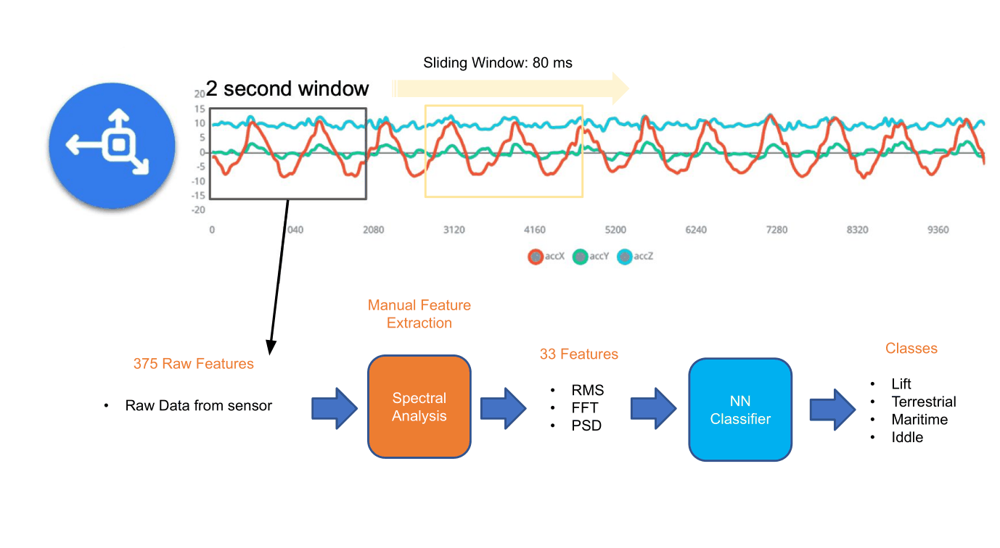

*Figura E3-S1 — O que os seus scripts vão reproduzir no PC: dados crus do sensor → janela de 375 números → análise espectral → classificador → classe. A análise espectral e o classificador vêm prontos dentro do `.eim`.*

| Parte | Tempo | Conteúdo |
|---|---|---|
| 0 | 20 min | O modelo como programa: baixar o `.eim` |
| A | 20 min | Comunicação básica PC ↔ ESP32 |
| B | 30 min | Extração de *features* |
| C | 45 min | Janela deslizante |
| D | 65 min | Classificação em tempo real + experimentos |
| — | 20 min | Relatório e commit |

**Antes de começar**

```bash
cd ~/sis-emb-2026-2 && git fetch && git reset --hard origin/main
mkdir -p ~/sis-emb/projeto-guiado/python
cp ~/sis-emb-2026-2/projeto-guiado-movimento/src/python/*.py ~/sis-emb/projeto-guiado/python/
cd ~/sis-emb/projeto-guiado/python
source ~/venv-ei/bin/activate           # em TODO terminal novo desta etapa
```

O ESP32 deve estar com o firmware `imu_serial` da Etapa 2, ligado na USB, e **nenhum outro
programa** (monitor, *data forwarder*) usando a porta.

> 🧪 **Sem hardware?** O simulador cria uma porta serial virtual que se comporta como o ESP32:
>
> ```bash
> python3 simulador_imu.py                 # terminal 1 — anote a porta, ex.: /dev/pts/4
> python3 01_leitor_serial.py --porta /dev/pts/4      # terminal 2
> ```
>
> Os sinais são sintéticos: servem para **testar o código**, não para avaliar o seu modelo.

---

## Parte 0 — O modelo como programa: o arquivo `.eim` (20 min)

### 0.1 O que é um `.eim`

Para rodar no Linux, o Edge Impulse **compila** o impulso inteiro (bloco espectral + rede +
K-means) num **executável nativo** — o `.eim` (*Edge Impulse Model*), otimizado para o
processador de destino (x86_64 no PC, aarch64 no Raspberry Pi). O seu script **não** carrega o
modelo dentro do Python: ele **inicia esse programa** e conversa com ele por um *socket*.

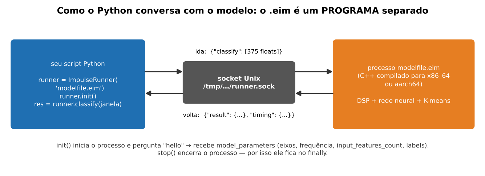

*Figura E3-A — `ImpulseRunner` é o "cliente" do SDK: `init()` inicia o `.eim` e pergunta suas
características; `classify(janela)` envia 375 números e recebe as probabilidades; `stop()` encerra o
processo.*

Consequência prática: **o `.eim` precisa ser da arquitetura da máquina onde roda**. O do PC não
roda no Raspberry Pi, e vice-versa (Etapa 4).

Onde estamos no fluxo de ML:

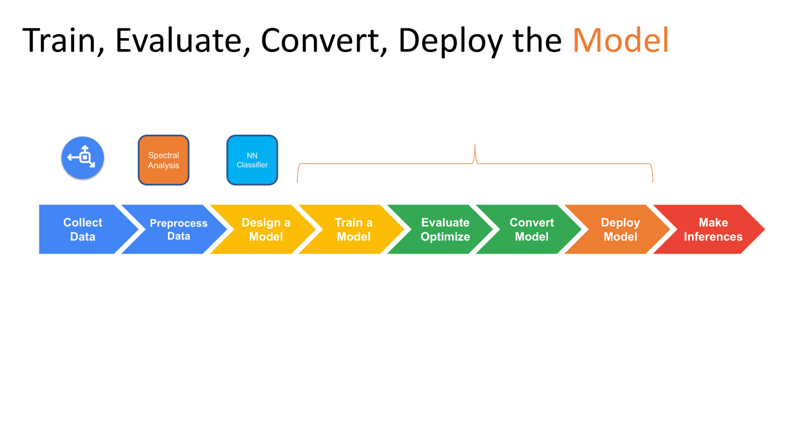

*Figura E3-S2 — O treino e a avaliação ficaram na Etapa 2. Agora vêm **converter, implantar e inferir**.*

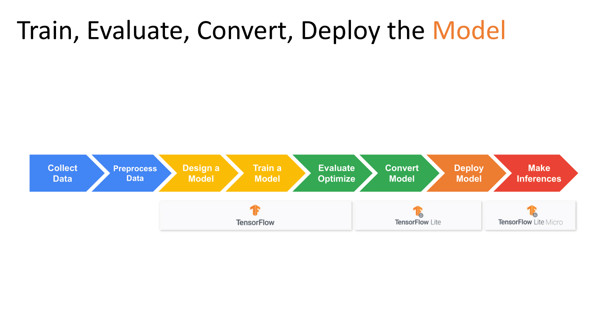

*Figura E3-S3 — A conversão é feita pelo Studio. Para Linux, em vez do TensorFlow Lite Micro dos microcontroladores, o resultado é o executável `.eim`.*

### 0.2 Baixe o modelo para o PC

```bash
cd ~/sis-emb/projeto-guiado/python
edge-impulse-linux-runner --clean --download modelfile.eim
```

Ele pede login, pergunta **qual projeto** (`movimento-bancada-N`), compila no servidor e salva o
arquivo:

```
Edge Impulse Linux runner v1.x.x
? What is your user name or e-mail address (edgeimpulse.com)? ...
? What is your password? [hidden]
? From which project do you want to load the model? <usuário> / movimento-bancada-N
[RUN] Downloading model...
[BLD] Created build job with ID XXXXXXX
...
[RUN] Downloading model OK
[RUN] Stored model in /home/aluno/sis-emb/projeto-guiado/python/modelfile.eim
```

```bash
ls -l modelfile.eim          # precisa ter o "x" de executável: -rwxr-xr-x
file modelfile.eim           # ELF 64-bit LSB ... x86-64
```

O `.eim` é grande e é gerado — não suba no GitHub: `echo "*.eim" >> ~/sis-emb/.gitignore`.

> 💡 **Ainda sem modelo próprio?** Baixe o do **clone do projeto de referência** (Etapa 1): rode o
> mesmo comando e escolha o projeto clonado. Ele foi treinado com outro sensor/montagem, então a
> acurácia com o seu ESP32 pode cair — mas serve para testar o código.
>
> 💡 **Retreinou o modelo no Studio?** Baixe de novo (o `.eim` é uma "foto" do modelo no momento
> do download). Sem `--clean`, ele usa o mesmo projeto sem perguntar.

---

## Parte A — Comunicação básica PC ↔ ESP32 (20 min)

### A.1 Descubra a porta

```bash
ls /dev/ttyUSB* /dev/ttyACM*
```

Placas com o chip CP2102 ou CH340 aparecem como `/dev/ttyUSB0`. Se houver dúvida, desconecte,
rode `ls` de novo e veja qual sumiu — ou use `dmesg | tail` logo após conectar (é o "monitor
serial do kernel", como na semana 11).

### A.2 O script pronto `01_leitor_serial.py`

```python
import argparse
import sys
import time

import serial  # pacote pyserial


def main():
    parser = argparse.ArgumentParser(description="Leitor serial do acelerômetro")
    parser.add_argument("--porta", default="/dev/ttyUSB0", help="porta serial do ESP32")
    parser.add_argument("--baud", type=int, default=115200, help="taxa da UART (bps)")
    args = parser.parse_args()

    try:
        # O 'with' garante que a porta será fechada mesmo se houver erro ou Ctrl+C.
        with serial.Serial(args.porta, args.baud, timeout=1) as ser:
            ser.reset_input_buffer()  # descarta o que acumulou antes de abrirmos
            n_linhas = 0
            t0 = time.monotonic()
            while True:
                # readline() lê bytes até o '\n' (ou até o timeout de 1 s)
                linha = ser.readline().decode("utf-8", errors="replace").strip()
                if linha:
                    print(f"Recebido: {linha}")
                    n_linhas += 1
                agora = time.monotonic()
                if agora - t0 >= 1.0:
                    print(f"---- taxa medida: {n_linhas / (agora - t0):.1f} linhas/s ----")
                    n_linhas = 0
                    t0 = agora
    except serial.SerialException as e:
        print(f"Erro crítico: não foi possível abrir a porta serial '{args.porta}'.")
        print(f"Detalhes: {e}")
        sys.exit(1)
    except KeyboardInterrupt:
        print("\nPrograma encerrado pelo usuário.")
    finally:
        print("Finalizando o programa.")
```

Pontos de Python que reaparecem em todos os scripts:

| Construção | Para quê |
|---|---|
| `argparse` | o mesmo script serve no PC (`/dev/ttyUSB0`) e no RPi, mudando só `--porta` |
| `with serial.Serial(...) as ser:` | **gerenciador de contexto**: fecha a porta ao sair do bloco, mesmo com erro — sem ele, a porta pode ficar "presa" |
| `try / except / finally` | trata o erro de porta (`SerialException`), o `Ctrl+C` (`KeyboardInterrupt`) e garante a finalização |
| `readline()` | lê até `\n` — o fim de linha do protocolo |
| `.decode("utf-8", errors="replace")` | bytes → texto, sem "explodir" com o lixo do *boot* |
| `.strip()` | remove `\r`, `\n` e espaços das pontas |
| `time.monotonic()` | relógio que nunca volta atrás (bom para medir intervalos) |

### A.3 Rode

```bash
python3 01_leitor_serial.py --porta /dev/ttyUSB0
```

Saída esperada: as linhas `Recebido: ...` e, a cada segundo, `taxa medida: 62.5 linhas/s`.

> 💡 Ao abrir a porta, o ESP32 normalmente **reinicia** (os sinais DTR/RTS do conversor USB
> acionam o circuito de *auto-reset* da placa). Por isso pode aparecer uma ou duas linhas
> estranhas no início — o *boot*. Os próximos scripts precisam **sobreviver** a essas linhas.

---

## Parte B — Extração de *features* (30 min)

Uma linha de texto `"1.23,-0.45,9.81"` ainda não é "dado": precisamos **validar** e
**converter** em três números com significado físico — as *raw features* do modelo. Requisitos:

1. separar a linha pela vírgula;
2. aceitar **apenas** linhas com exatamente 3 campos; descartar as outras com um aviso;
3. converter cada campo para `float` e atribuí-lo a uma variável com nome físico (`acc_x`,
   `acc_y`, `acc_z`);
4. tratar `ValueError` (texto que não é número) sem derrubar o programa.

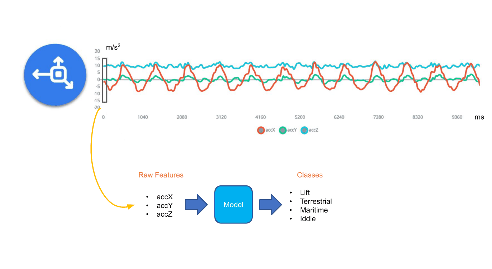

*Figura E3-S4 — A Parte B produz **uma amostra**: os 3 valores `accX, accY, accZ` de um instante…*

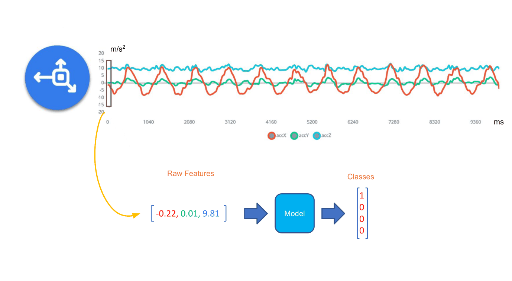

*Figura E3-S5 — …como um vetor de 3 _floats_. Sozinho, ele ainda não basta para classificar (Etapa 1, A.4); a Parte C junta 125 deles.*

### B.1 Complete os TODOs de `02_extrai_features.py`

```python
def process_line(line_str):
    """
    Processa UMA linha de texto: valida, extrai e converte os dados.
    Retorna [acc_x, acc_y, acc_z] (floats, em m/s²) ou None se a linha for inválida.
    """
    # Divide a linha em partes usando a vírgula como separador
    partes = ...  # TODO 1: separe line_str pela vírgula (método split)
    if len(partes) == 3:
        try:
            # Converte cada parte para float
            acc_x = ...  # TODO 2: converta o 1º campo para float
            acc_y = ...  # TODO 3: converta o 2º campo para float
            acc_z = ...  # TODO 4: converta o 3º campo para float
            return [acc_x, acc_y, acc_z]
        except (ValueError, IndexError):
            print(f"Aviso: não foi possível converter a linha: '{line_str}'")
            return None
    else:
        if line_str:
            print(f"Aviso: linha malformada ignorada: '{line_str}'")
        return None
```

> 💡 Teste a função isoladamente antes de ligar a serial:
>
> ```bash
> python3 -c "
> import importlib; m = importlib.import_module('02_extrai_features')
> print(m.process_line('1.5,-2.25,9.81'))     # [1.5, -2.25, 9.81]
> print(m.process_line('ets Jun  8 2016'))    # aviso + None
> print(m.process_line('1.5,abc,9.81'))       # aviso + None
> "
> ```

### B.2 Rode

```bash
python3 02_extrai_features.py --porta /dev/ttyUSB0
```

```
Etapa 3-B: extração de features...
Porta serial '/dev/ttyUSB0' aberta com sucesso.
Aviso: linha malformada ignorada: 'ets Jun  8 2016 00:22:57'
X:    0.05  Y:   -0.07  Z:    9.82  (m/s²)
X:    0.04  Y:   -0.08  Z:    9.83  (m/s²)
```

> 📝 **Relatório (Etapa 3, Q1):** quais linhas "estranhas" apareceram ao iniciar? O que aconteceria
> com o programa se não houvesse o `try/except`?

---

## Parte C — Janela deslizante (45 min)

### C.1 O conceito

O modelo foi treinado com janelas de **2 s = 125 amostras**. Em tempo real, mantemos uma lista com
as amostras mais recentes; quando ela tem 125 amostras, **processamos** e então descartamos as
`STRIDE` mais antigas — a janela "desliza" e a próxima decisão sai `STRIDE` amostras depois.

Recapitulando a Etapa 1, A.4:

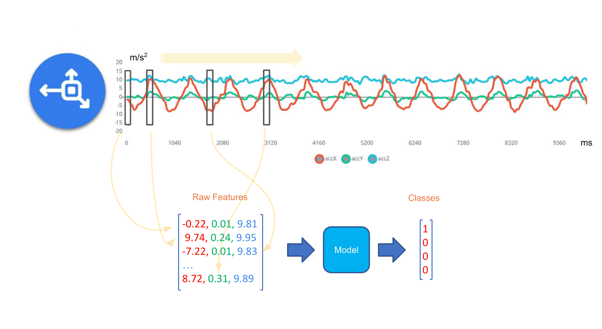

*Figura E3-S6 — Amostras soltas do mesmo movimento são muito diferentes entre si…*

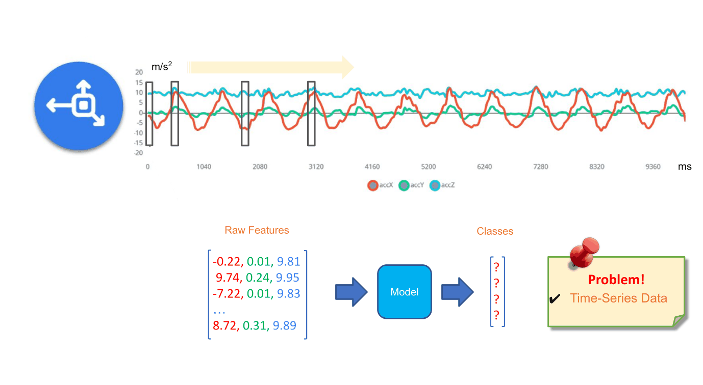

*Figura E3-S7 — …por isso o modelo precisa de um trecho da série temporal…*

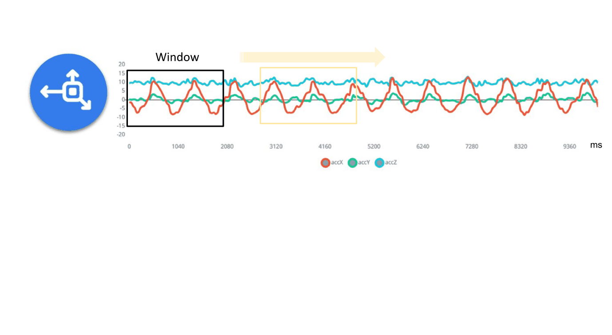

*Figura E3-S8 — …uma **janela** que desliza sobre o sinal…*

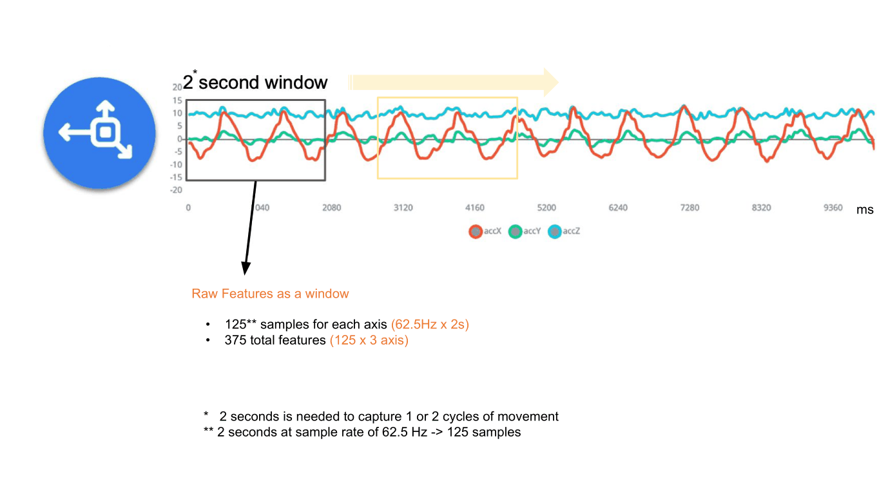

*Figura E3-S9 — …de 2 s: 125 amostras × 3 eixos = 375 números, exatamente o que o `.eim` espera receber.*

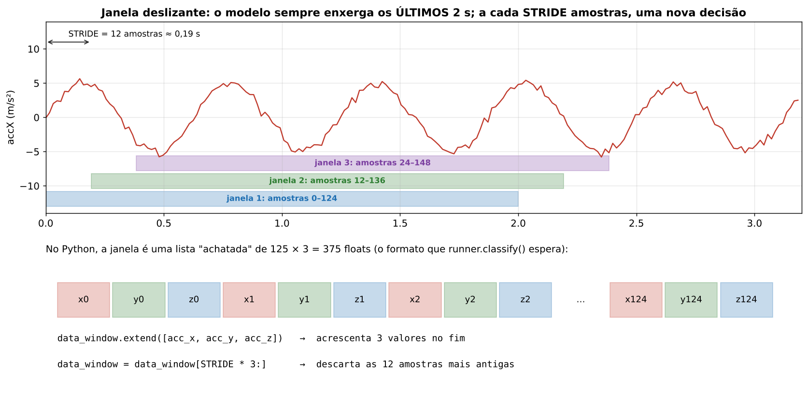

*Figura E3-B — Com `WINDOW_SIZE = 125` e `STRIDE = 12`, cada janela compartilha 113 amostras com a
anterior, e sai uma decisão a cada 12/62,5 ≈ 0,19 s.*

> **Exemplo resolvido 3.1 — os números da janela.** Exemplo pequeno: `WINDOW_SIZE = 10`,
> `STRIDE = 4`. Janela 1 = `[d1 … d10]` → processa → descarta `d1…d4` → sobra `[d5 … d10]` →
> chegam `d11 … d14` → Janela 2 = `[d5 … d14]`. No projeto: a 1ª decisão sai após 125/62,5 =
> **2,0 s**; depois, uma a cada 12/62,5 = **0,192 s** (≈ 5,2 decisões por segundo).

**Por que uma lista "achatada"?** O SDK espera as *raw features* exatamente como o Studio as vê:
`[x0, y0, z0, x1, y1, z1, …]` — 375 floats. Então guardamos tudo numa lista só, com `extend`
(acrescenta os 3 valores) em vez de `append` (acrescentaria **uma** lista dentro da lista). Por
isso a janela está cheia quando `len(data_window) >= WINDOW_SIZE * 3` e o deslizamento remove
`STRIDE * 3` valores.

> 💡 **Treino × uso.** No Studio, o *window increase* (80 ms = 5 amostras) só define quantas janelas
> de **treino** são fatiadas. Em tempo real, o `STRIDE` é escolha **sua**: menor = decisões mais
> frequentes e mais CPU; maior = menos CPU e resposta mais "degrau".

### C.2 Complete os TODOs de `03_janela_deslizante.py`

```python
# Hiperparâmetros da janela deslizante
EIXOS = 3            # accX, accY, accZ
WINDOW_SIZE = 125    # amostras por janela (2 s a 62,5 Hz)
STRIDE = 12          # amostras descartadas a cada janela processada


def process_line(line_str):
    """Mesma função da Parte B: devolve [acc_x, acc_y, acc_z] ou None."""
    # TODO 1: cole aqui o corpo da process_line que você completou na Parte B
    ...

# (...)
            while True:
                line_str = ser.readline().decode("utf-8", errors="replace").strip()
                if line_str:
                    features = process_line(line_str)
                    if features:
                        # TODO 2: acrescente os 3 valores de features no FIM de data_window
                        #         (dica: a lista é "achatada" — use extend, não append)
                        ...

                # janela cheia? (WINDOW_SIZE amostras × 3 eixos)
                if ...:  # TODO 3: a janela tem WINDOW_SIZE amostras de EIXOS valores?
                    agora = time.monotonic()
                    n_janela += 1
                    process_window(data_window, n_janela, agora - t_ant)
                    t_ant = agora
                    # desliza: remove as STRIDE amostras mais antigas (STRIDE × 3 valores)
                    data_window = ...  # TODO 4: descarte as STRIDE amostras mais antigas
```

> 💡 **Fatiamento de listas em Python:** `lista[k:]` devolve a lista **sem** os `k` primeiros
> elementos. Ex.: `[1,2,3,4,5][2:]` → `[3,4,5]`.

### C.3 Rode

```bash
python3 03_janela_deslizante.py --porta /dev/ttyUSB0
```

```
Etapa 3-C: janela deslizante...
Porta serial '/dev/ttyUSB0' aberta com sucesso.
--- Janela 1: 125 amostras (375 valores), 2.01 s desde a anterior ---
  Primeira amostra: [0.0479, -0.0718, 9.8211]
  Última amostra:   [0.0431, -0.0766, 9.8307]
--- Janela 2: 125 amostras (375 valores), 0.19 s desde a anterior ---
...
```

> 📝 **Relatório (Etapa 3, Q2):** o tempo entre janelas medido bate com o Exemplo 3.1? Troque
> `STRIDE` para 62 e para 125 e anote o novo intervalo. O que significa `STRIDE = WINDOW_SIZE`?

---

## Parte D — Classificação em tempo real (65 min)

### D.1 O que muda em relação à Parte C

1. Importamos o SDK: `from edge_impulse_linux.runner import ImpulseRunner`.
2. Iniciamos o modelo: `runner = ImpulseRunner(caminho)` e `model_info = runner.init()`.
3. O **tamanho da janela vem do modelo**, não de uma constante: `input_features_count` (375) ÷
   `axis_count` (3) = 125. Se alguém mudar o *Window size* no Studio e baixar um modelo novo, o
   script se adapta — e ainda **acusa** se a frequência do modelo não for 62,5 Hz (o contrato).
4. Cada janela cheia vai para `runner.classify(janela)`, que devolve um dicionário:

```python
{
  "result": {
     "classification": {"idle": 0.01, "lift": 0.02, "maritime": 0.95, "terrestrial": 0.02},
     "anomaly": -0.31                     # só existe se o impulso tiver o bloco K-means
  },
  "timing": {"dsp": 1, "classification": 0, "anomaly": 0}   # em ms, medidos dentro do .eim
}
```

5. `runner.stop()` no `finally` encerra o processo `.eim` (senão ele fica "órfão" no sistema).

O que acontece dentro de `runner.classify(janela)`:

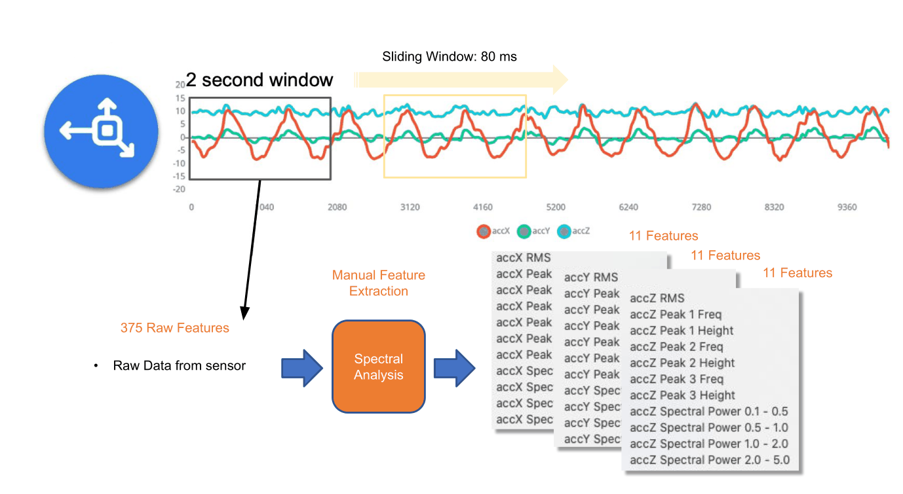

*Figura E3-S10 — Primeiro, o `.eim` transforma os 375 números nas _features_ espectrais…*

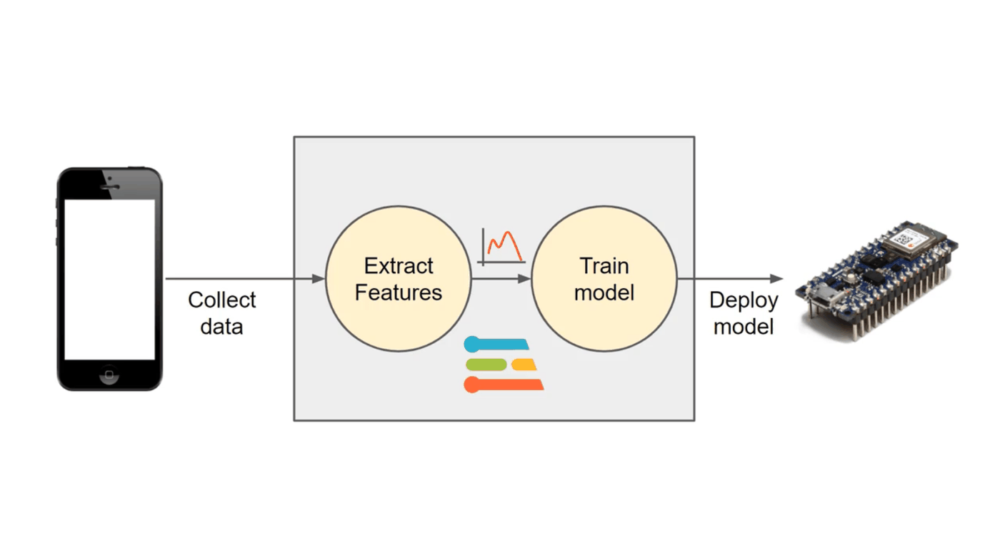

*Figura E3-S11 — …e depois passa as _features_ à rede treinada: _extrair features_ e _treinar_ foram feitos no Studio, e o `.eim` leva as duas partes para o PC.*

### D.2 Complete os TODOs de `04_classifica.py`

```python
def process_window(window_data, runner, limiar, t_inicio, log):
    """Classifica UMA janela e imprime o resultado de forma legível."""
    t0 = time.perf_counter()
    res = ...  # TODO 2: entregue a janela ao modelo (método classify do runner)
    t_total_ms = (time.perf_counter() - t0) * 1000.0

    scores = res["result"]["classification"]           # {'idle': 0.01, 'lift': 0.97, ...}
    classe = ...  # TODO 3: rótulo de MAIOR probabilidade (dica: max com key=scores.get)
    conf = scores[classe]
    anomalia = res["result"].get("anomaly")             # só existe se houver bloco K-means
    # (... impressão e CSV ...)

# (... em main(), depois de runner.init() ...)
        eixos = mp.get("axis_count", 3)
        window_size = ...  # TODO 4: amostras por janela = input_features_count ÷ eixos

# (... no laço ...)
                    if features:
                        ...  # TODO 5: acrescente features ao fim de data_window

                if len(data_window) >= window_size * eixos:
                    process_window(data_window, runner, args.limiar, t_inicio, log)
                    data_window = ...  # TODO 6: deslize a janela (descarte STRIDE amostras)
```

(O TODO 1 é, de novo, colar a sua `process_line`.)

> 💡 `max(scores, key=scores.get)` percorre as **chaves** do dicionário e devolve aquela cujo
> **valor** é maior. Ex.: `max({"a": 0.2, "b": 0.7}, key={"a": 0.2, "b": 0.7}.get)` → `"b"`.
> E use **divisão inteira** (`//`) no TODO 4: o número de amostras não pode ser `125.0`.

### D.3 Rode

```bash
python3 04_classifica.py ./modelfile.eim --porta /dev/ttyUSB0
```

```
Etapa 3-D: classificação de dados...
Carregado o runner para "Fulano / movimento-bancada-N"
Modelo: 3 eixos, 62.5 Hz, janela de 125 amostras (2.00 s), rótulos ['idle', 'lift', 'maritime', 'terrestrial']
Porta serial '/dev/ttyUSB0' aberta com sucesso.
[   2.03 s] idle                   conf 0.99 | anomalia  -0.45 | dsp 0 ms, nn 0 ms, total 0.9 ms
[   2.22 s] idle                   conf 0.99 | anomalia  -0.47 | dsp 0 ms, nn 0 ms, total 0.8 ms
...
[  14.80 s] lift                   conf 0.97 | anomalia  -0.12 | dsp 0 ms, nn 0 ms, total 0.9 ms
```

Faça os 4 movimentos, com calma, e observe. Salve ~30 s de saída nas evidências (o `tee` mostra
na tela **e** grava no arquivo):

```bash
mkdir -p ../evidencias
python3 04_classifica.py ./modelfile.eim --porta /dev/ttyUSB0 --csv ../evidencias/e3_inferencias_pc.csv \
        | tee ../evidencias/e3_classificacao_pc.txt
```

### D.4 Experimentos (anote no relatório)

| # | Faça | Pergunta |
|---|---|---|
| 1 | Passe de `idle` para `lift` e conte quanto tempo a classe leva para mudar (use o tempo `[t s]`) | O atraso é compatível com a janela de 2 s? Por que a mudança não é instantânea? |
| 2 | Rode com `--limiar 0.9` e faça movimentos "no meio do caminho" entre duas classes | Quantas decisões viram `incerto`? Para que serve um limiar? |
| 3 | Faça um movimento nunca visto (girar a protoboard, batidinhas) | O que acontece com a classe e com a anomalia? Qual limiar de anomalia você usaria? |
| 4 | Anote os tempos `dsp`, `nn` e `total` | Quantas inferências por segundo o PC aguentaria? E o firmware entrega quantas janelas novas por segundo? |
| 5 | (contrato) Gire a protoboard **de lado** e repita `lift` | A acurácia cai? Explique pela gravidade (Etapa 2, experimento B.5-2) |

> 📝 **Relatório (Etapa 3, Q3):** respostas dos 5 experimentos. Compare a acurácia "a olho" no
> uso real com a acurácia de teste do Studio.

> 📝 **Relatório (Etapa 3, Q4) — latência total.** Estime o tempo entre o **início** de um
> movimento e a classe correta aparecer: (tempo para o movimento ocupar a maior parte da janela) +
> (espera até o próximo `STRIDE`) + (tempo de inferência) + (transmissão serial). Qual parcela
> domina? Como você reduziria a latência — e qual o preço?

### ✅ Chegamos (fim do encontro 3)

- [ ] `02`, `03` e `04` completos e funcionando com o ESP32.
- [ ] Classificação em tempo real no PC + CSV gravado.
- [ ] Experimentos 1–5 anotados.
- [ ] Commit: `projeto-guiado: etapa 3 — inferência no PC`.

> 💡 **Para a Etapa 4:** leve os seus `02`, `03` e `04` completos — eles vão rodar **sem alteração**
> no Raspberry Pi. Se possível, grave o cartão do RPi **antes** do encontro 4 (Parte A da Etapa 4).
