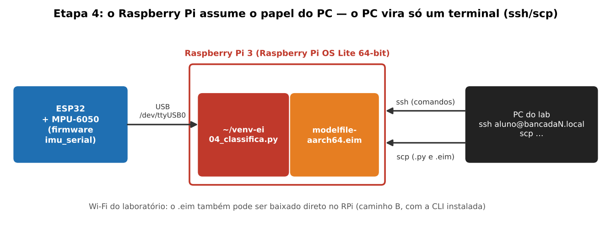
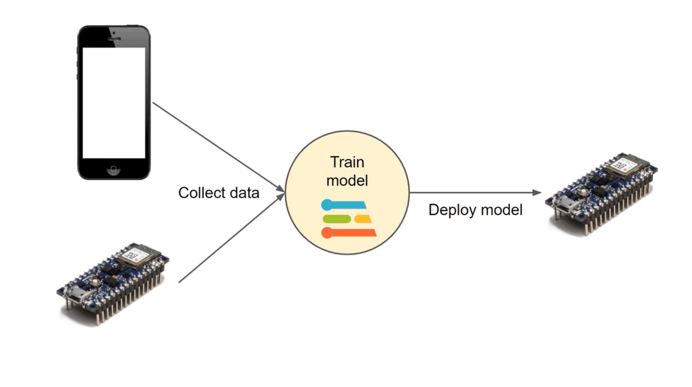
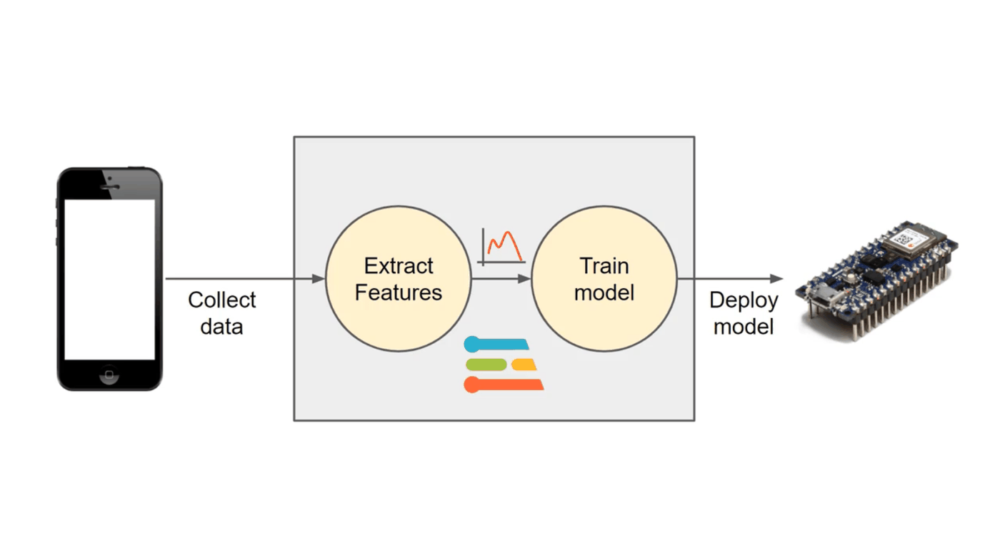
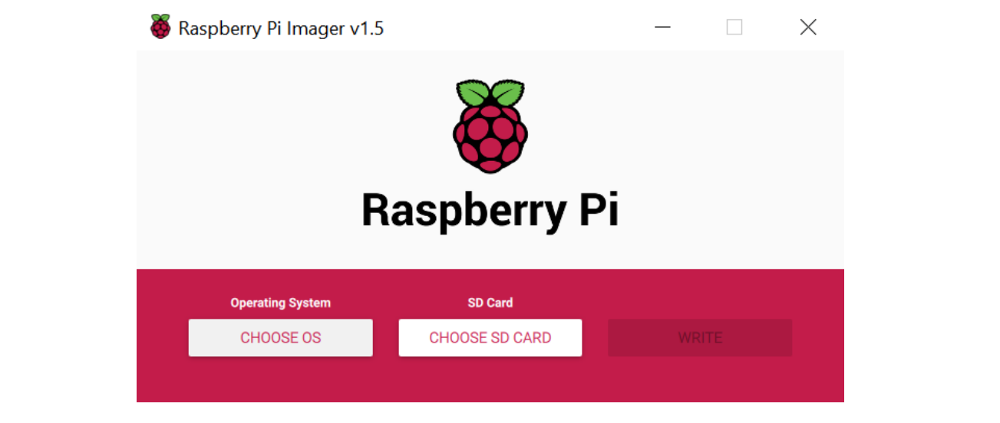
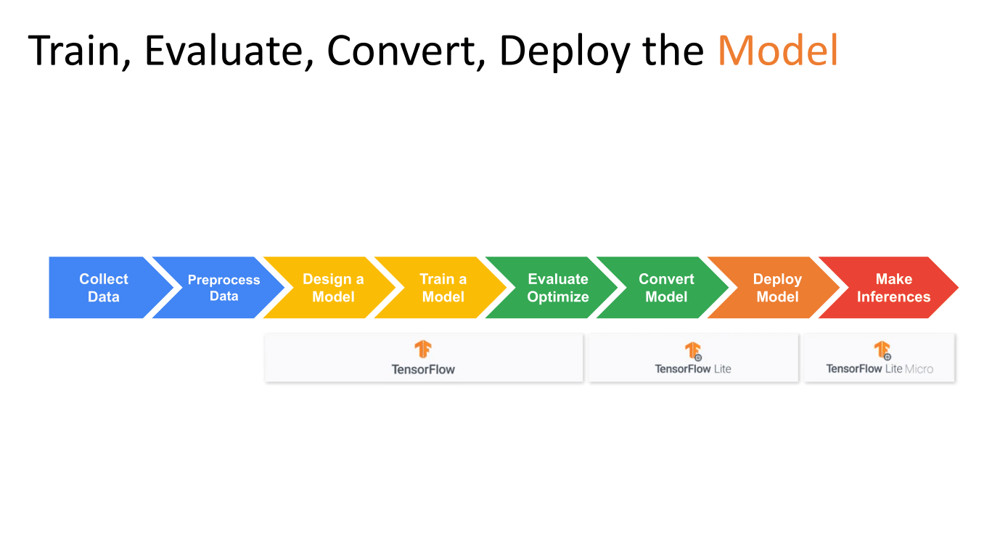
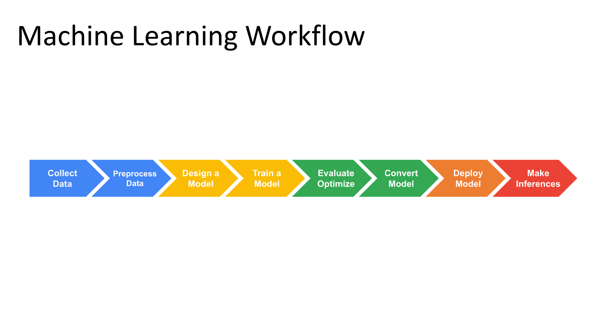

# Etapa 4 — Coleta e classificação com um computador de placa única (Raspberry Pi)

**Encontro 4 (4 aulas = 200 min)** · [← Etapa 3](etapa-3-inferencia-pc.md) · [visão geral](README-projeto-guiado.md)

**Objetivo:** levar o sistema da Etapa 3 para um **computador de placa única** (*Single-Board
Computer*, SBC): o Raspberry Pi passa a ler o ESP32 e a classificar os movimentos sozinho; o PC
vira apenas um terminal remoto (SSH).



*Figura E4-A — A arquitetura final. O mesmo firmware no ESP32, os mesmos scripts Python — só
muda a máquina que os executa (e o `.eim`, compilado para ARM de 64 bits).*

| Parte | Tempo | Conteúdo |
|---|---|---|
| A | 15 min | Teoria: microcontrolador × SBC × PC |
| B | 35 min | Gravar o Raspberry Pi OS (*headless*) |
| C | 25 min | Primeiro acesso por SSH |
| D | 30 min | Bibliotecas Python e SDK no RPi |
| E | 20 min | O modelo para ARM: `.eim` aarch64 |
| F | 50 min | Os scripts das Etapas 3 rodando no RPi + comparação PC × RPi |
| G | 25 min | Encerramento, entrega e desligamento correto |
| H | — | (opcional) Edge Impulse CLI no RPi e *data forwarder* a partir do RPi |

> ⏱️ **Economize tempo:** a Parte B (gravar o cartão) pode ser feita **antes** do encontro, em
> qualquer PC com leitor de cartão. A Parte D roda sozinha por ~10 min — avance na Parte E
> enquanto isso.

---

## Parte A — Teoria: onde o SBC se encaixa (15 min)

| | ESP32 (microcontrolador) | Raspberry Pi 3 (SBC) | PC do laboratório |
|---|---|---|---|
| Processador | Xtensa LX6, 2 núcleos, 240 MHz | ARM Cortex-A53 (BCM2837), 4 núcleos, 1,2 GHz, **64 bits** | x86-64, vários GHz |
| Memória | 520 KB de SRAM | **1 GB** de RAM + cartão microSD | 8–16 GB |
| Sistema | FreeRTOS (tempo real, sem MMU de processos) | **Linux** completo (processos, arquivos, rede, Python, `apt`) | Linux |
| Boot | milissegundos | ~30 s | ~30 s |
| Consumo típico | ~0,1–0,5 W | ~2–4 W | 50–150 W |
| Papel no projeto | **sensor**: amostra a 62,5 Hz cravados | **borda**: janela + inferência + decisão | desenvolvimento e treino (via Studio) |

O SBC ocupa o meio do caminho: tem **Linux** (logo, roda o mesmo Python e o mesmo tipo de `.eim`
do PC), mas é pequeno, barato e de baixo consumo — pode ficar **junto** do equipamento
monitorado. O ESP32 continua fazendo o que faz melhor: **tempo real** na aquisição. Essa divisão
de trabalho (MCU para o tempo real + SBC para o processamento) é muito comum em produtos.

> 🖼️ As figuras com numeração **S** (de *slides*) vêm da apresentação da disciplina *Ingestão de Dados de IMU* e estão em inglês. Nelas, *Lift* = `lift`, *Terrestrial* = `terrestrial`, *Maritime* = `maritime` e *Idle* (às vezes grafado *Iddle*) = `idle`.



*Figura E4-S1 — Coletar em um dispositivo e implantar em outro: no nosso caso, o ESP32 coleta, o Studio treina e o Raspberry Pi executa o modelo.*



*Figura E4-S2 — O que vai para o RPi: a extração de _features_ e o modelo treinado, juntos no `.eim` (agora compilado para ARM).*

> ⚠️ **ARM ≠ x86.** O Raspberry Pi 3 roda instruções **ARM (aarch64)**; o PC, **x86-64**. Scripts
> Python são portáveis (o interpretador traduz), mas **executáveis compilados não são** — o
> `modelfile.eim` do PC não roda no RPi. Por isso a Parte E.

---

## Parte B — Gravar o Raspberry Pi OS em modo *headless* (35 min)

*Headless* = sem monitor e sem teclado: toda a configuração vai no cartão, e o primeiro acesso já
é por rede.

1. No PC, instale e abra o **Raspberry Pi Imager**:

   ```bash
   sudo apt install -y rpi-imager      # ou: sudo snap install rpi-imager
   rpi-imager
   ```



*Figura E4-B — O Imager. Fonte: Raspberry Pi and MQTT Essentials (Packt), cap. 1, Fig. 1.20.*

2. Escolha:
   - *Raspberry Pi Device*: **Raspberry Pi 3**;
   - *Operating System*: **Raspberry Pi OS (other) → Raspberry Pi OS Lite (64-bit)** (Lite = sem
     interface gráfica: sobra RAM e o boot é mais rápido; **64-bit** = aarch64);
   - *Storage*: o cartão microSD (**confira o tamanho** para não apagar outro disco!).
3. **Next → Edit settings** (a "personalização do SO" — o passo que torna o *headless* possível):

| Aba | Campo | Valor |
|---|---|---|
| *General* | *hostname* | `bancadaN` (N = número da bancada) |
| | *username / password* | `aluno` / senha combinada com o professor |
| | *Configure wireless LAN* | SSID e senha do Wi-Fi do laboratório; país **BR** |
| | *Locale settings* | fuso `America/Sao_Paulo`, teclado `br` |
| *Services* | *Enable SSH* | **marcado**, *Use password authentication* |

4. **Save → Yes → Yes**, digite a senha do PC e aguarde (~5–10 min). Ao final, **Continue** e
   retire o cartão.
5. Insira o cartão no RPi e **só então** ligue a fonte (≥ 2,5 A). O LED verde pisca (leitura do
   cartão). O **primeiro** boot demora mais (~1–2 min): o sistema expande a partição para ocupar o
   cartão inteiro.

> 💡 Ficou sem tempo? O roteiro da [semana 11](../semana-11/lab-11.md) (Parte A) traz este mesmo
> procedimento com mais detalhes e o "boot em 5 atos" explicado na [teoria-11](../semana-11/teoria-11.md).

---

## Parte C — Primeiro acesso por SSH (25 min)

**SSH** (*Secure Shell*) abre um terminal **cifrado** numa máquina remota: tudo o que você digitar
roda **no RPi**.

```bash
ping -c 3 bancadaN.local
ssh aluno@bancadaN.local
```

No primeiro acesso:

```
The authenticity of host 'bancadaN.local (192.168.x.y)' can't be established.
ED25519 key fingerprint is SHA256:....
Are you sure you want to continue connecting (yes/no/[fingerprint])? yes
aluno@bancadaN.local's password:
aluno@bancadaN:~ $
```

> 💡 O nome `bancadaN.local` funciona por **mDNS** (o RPi anuncia o próprio nome na rede local).
> Se o `ping` falhar: espere mais 1 minuto; confira se o PC está na mesma rede; plano B: descubra o
> IP do RPi (no roteador/lista do professor) e use `ssh aluno@IP`.

Explore o sistema e **anote no relatório**:

```bash
uname -m                      # aarch64  ← a arquitetura que define o .eim
cat /proc/device-tree/model   # Raspberry Pi 3 Model B Rev 1.2
free -h                       # ~1 GB de RAM (compare com 520 KB do ESP32)
df -h /                       # espaço no cartão
python3 --version             # Python 3.11+ (Bookworm) ou 3.13 (Trixie)
```

> 📝 **Relatório (Etapa 4, Q1):** saídas dos 5 comandos e, para cada uma, uma frase sobre o que ela
> revela (ex.: "`free -h` → 2000× a RAM do ESP32").

Atualize o sistema (pode levar alguns minutos — avance lendo a Parte D):

```bash
sudo apt update && sudo apt full-upgrade -y
```

---

## Parte D — Bibliotecas Python e SDK no RPi (30 min)

### D.1 Leve os arquivos do projeto para o RPi

O caminho mais simples é clonar o repositório da disciplina **no RPi**:

```bash
# no RPi (via ssh):
sudo apt install -y git
git clone https://github.com/fabiobento/sis-emb-2026-2.git ~/sis-emb-2026-2
```

E copiar os **seus** scripts completos do PC para o RPi com `scp` (*secure copy*, usa o mesmo
login do SSH):

```bash
# no PC (outro terminal, SEM ssh):
ssh aluno@bancadaN.local "mkdir -p ~/projeto-mov"
scp ~/sis-emb/projeto-guiado/python/0*.py aluno@bancadaN.local:~/projeto-mov/
```

### D.2 Instale as bibliotecas

```bash
# no RPi:
cd ~/sis-emb-2026-2/projeto-guiado-movimento/src/scripts
bash instalar_rpi.sh
sudo reboot
```

O que o script faz (e por quê):

| Passo | Comando | Por quê |
|---|---|---|
| pacotes do sistema | `sudo apt install python3-venv python3-numpy python3-serial python3-six python3-pyaudio python3-opencv` | versões pré-compiladas para ARM — compilar `numpy`/`opencv` num RPi 3 levaria horas |
| ambiente virtual | `python3 -m venv --system-site-packages ~/venv-ei` | o Raspberry Pi OS bloqueia `pip install` no Python do sistema (`externally-managed-environment`); a venv enxerga os pacotes do `apt` |
| SDK | `~/venv-ei/bin/pip install edge_impulse_linux` | o `ImpulseRunner` |
| porta serial | `sudo usermod -a -G dialout $USER` | acesso a `/dev/ttyUSB0` sem `sudo` (vale após o *reboot*) |

Depois do *reboot* (≈ 40 s), reconecte e confira:

```bash
ssh aluno@bancadaN.local
source ~/venv-ei/bin/activate
python -c "from edge_impulse_linux.runner import ImpulseRunner; import serial; print('SDK ok')"
groups | grep dialout
```

---

## Parte E — O modelo para ARM: `.eim` aarch64 (20 min)



*Figura E4-S3 — Converter e implantar para o novo alvo: o Studio compila o mesmo impulso para a arquitetura do RPi (aarch64).*

Escolha **um** dos caminhos.

**Caminho A (recomendado) — baixar no PC e copiar.** O `edge-impulse-linux-runner` do PC pode
baixar o modelo compilado **para outra arquitetura**:

```bash
# no PC:
cd ~/sis-emb/projeto-guiado/python
edge-impulse-linux-runner --download modelfile-aarch64.eim --force-target runner-linux-aarch64
file modelfile-aarch64.eim         # ELF 64-bit LSB ... ARM aarch64
scp modelfile-aarch64.eim aluno@bancadaN.local:~/projeto-mov/
```

**Caminho A' — pelo navegador.** No Studio, menu **Deployment** → procure **"Linux (AARCH64)"** →
**Build**. O navegador baixa um arquivo `.eim`; copie-o com `scp` como acima.

**Caminho B — direto no RPi**, com a CLI instalada no próprio RPi (Parte H, demora mais):

```bash
# no RPi:
edge-impulse-linux-runner --clean --download ~/projeto-mov/modelfile-aarch64.eim
```

Em qualquer caminho, **no RPi**:

```bash
cd ~/projeto-mov
chmod +x modelfile-aarch64.eim       # o scp pode não preservar a permissão de execução
ls -l
```

> ⚠️ Se `uname -m` mostrou `armv7l` (sistema de **32 bits**), use `runner-linux-armv7` /
> "Linux (ARMv7)". Rodar o `.eim` errado dá `Exec format error`.

---

## Parte F — Os scripts das Etapas 3 rodando no RPi (50 min)

### F.1 Ligue o ESP32 no RPi

Tire o cabo USB do ESP32 do PC e ligue-o numa porta USB do **Raspberry Pi**. No RPi:

```bash
dmesg | tail -5             # o kernel narra: "cp210x converter now attached to ttyUSB0"
ls /dev/ttyUSB*
```

> 💡 O ESP32 é alimentado pela USB do RPi (~80 mA). Se o RPi reiniciar ou mostrar subtensão
> (`dmesg | grep -i voltage`), a fonte do RPi está fraca.

### F.2 Os quatro passos, de novo — agora no RPi

Em cada passo, rode e compare a saída com a do PC. Os scripts são **os mesmos**.

```bash
source ~/venv-ei/bin/activate
cd ~/projeto-mov

python3 01_leitor_serial.py --porta /dev/ttyUSB0          # Parte A: taxa ≈ 62,5 linhas/s?
python3 02_extrai_features.py --porta /dev/ttyUSB0        # Parte B
python3 03_janela_deslizante.py --porta /dev/ttyUSB0      # Parte C: 0,19 s entre janelas?
python3 04_classifica.py ./modelfile-aarch64.eim --porta /dev/ttyUSB0 --csv inferencias_rpi.csv \
        | tee e4_classificacao_rpi.txt                     # Parte D
```

Saída esperada (os tempos serão maiores que no PC):

```
Etapa 3-D: classificação de dados...
Carregado o runner para "Fulano / movimento-bancada-N"
Modelo: 3 eixos, 62.5 Hz, janela de 125 amostras (2.00 s), rótulos ['idle', 'lift', 'maritime', 'terrestrial']
Porta serial '/dev/ttyUSB0' aberta com sucesso.
[   2.05 s] maritime               conf 0.93 | anomalia  -0.28 | dsp 2 ms, nn 0 ms, total 4.1 ms
```

### F.3 Monitore o RPi enquanto ele classifica

Abra **outra** sessão SSH e observe o uso de CPU e memória:

```bash
ssh aluno@bancadaN.local
top            # procure os processos python3 e modelfile-aarch64.eim; sai com q
vcgencmd measure_temp
```

### F.4 Comparação PC × RPi

Preencha (use as últimas colunas do CSV para calcular a média do tempo total):

| Métrica | PC (Etapa 3) | RPi 3 (Etapa 4) |
|---|---|---|
| Arquitetura (`uname -m`) | x86_64 | aarch64 |
| Taxa medida pelo `01` (linhas/s) | | |
| Tempo `dsp` típico (ms) | | |
| Tempo `nn` típico (ms) | | |
| Tempo `total` médio por inferência (ms) | | |
| % de CPU do `.eim` + `python3` (no `top`) | | |
| A classificação "parece" igual? | | |

Para a média do tempo total a partir do CSV:

```bash
python3 -c "
import csv; v=[float(r['tempo_ms']) for r in csv.DictReader(open('inferencias_rpi.csv'))]
print(f'{len(v)} inferências, tempo médio {sum(v)/len(v):.2f} ms, máximo {max(v):.2f} ms')"
```

> 📝 **Relatório (Etapa 4, Q2):** a tabela preenchida. O RPi 3 dá conta do tempo real? (Compare o
> tempo por inferência com o intervalo de 192 ms entre janelas.) Quantas vezes mais lento ele é que
> o PC? Que outro trabalho o RPi poderia fazer com a CPU que sobra?

> 📝 **Relatório (Etapa 4, Q3) — projeto.** Desenhe (pode ser à mão, foto no relatório) a
> arquitetura de um produto real para o cenário de transporte de cargas: onde fica cada parte
> (ESP32, RPi, nuvem), o que trafega entre elas e por quê. Onde entraria o MQTT da semana 14?

---

## Parte G — Encerramento, entrega e desligamento (25 min)

1. Traga as evidências do RPi para o PC:

   ```bash
   # no PC:
   cd ~/sis-emb/projeto-guiado/evidencias      # no diretório da SUA bancada (sincronizado com o GitHub)
   scp aluno@bancadaN.local:~/projeto-mov/e4_classificacao_rpi.txt .
   scp aluno@bancadaN.local:~/projeto-mov/inferencias_rpi.csv ./e4_inferencias_rpi.csv
   ```

2. **Desligue o RPi corretamente** — arrancar a fonte com o sistema rodando pode corromper o
   cartão:

   ```bash
   sudo poweroff        # espere o LED verde parar de piscar antes de tirar a fonte
   ```

3. Complete o `relatorio.md` e faça o commit final:
   `projeto-guiado: etapa 4 — inferência no Raspberry Pi`. Confira a lista de entrega no
   [README do projeto](README-projeto-guiado.md#entrega-github-da-bancada-pasta-projeto-guiado).

Você percorreu o fluxo inteiro:



*Figura E4-S4 — Da coleta (Etapa 2) à inferência na borda (Etapas 3 e 4).*


*Figura E4-S5 — O resumo do fluxo nos slides. Compare com o que a sua bancada fez em cada etapa.*

### ✅ Chegamos (fim do projeto)

- [ ] Raspberry Pi OS gravado e acessado por SSH.
- [ ] SDK instalado na venv; `.eim` aarch64 executável no RPi.
- [ ] Os 4 scripts rodando no RPi com o ESP32 ligado nele.
- [ ] Tabela PC × RPi preenchida; evidências e relatório no GitHub.

---

## Parte H — (opcional) Edge Impulse CLI no RPi e coleta a partir do RPi

Com a CLI no próprio RPi, ele pode fazer **também** o papel do PC na Etapa 2 (coletar dados com o
*data forwarder*) e baixar modelos sozinho. A instalação compila módulos nativos e demora
**20–40 min** num RPi 3:

```bash
# no RPi:
cd ~/sis-emb-2026-2/projeto-guiado-movimento/src/scripts
bash instalar_rpi.sh --com-cli
source ~/.bashrc
edge-impulse-data-forwarder --version
```

O que o `--com-cli` acrescenta:

| Componente | Função |
|---|---|
| **Node.js 22** (NodeSource) | ambiente de execução JavaScript fora do navegador — a CLI do Edge Impulse é escrita em JavaScript |
| `edge-impulse-cli` | `edge-impulse-data-forwarder`, `edge-impulse-uploader`, `edge-impulse-daemon`… (coleta) |
| `edge-impulse-linux` | `edge-impulse-linux-runner` (baixar/rodar `.eim`) e `edge-impulse-linux` (câmera/microfone do próprio RPi) |

Coleta a partir do RPi (ESP32 ligado no RPi):

```bash
edge-impulse-data-forwarder --clean --frequency 62.5
```

As perguntas e a saída são as mesmas da [Etapa 2, Parte C](etapa-2-ingestao.md#parte-c--data-forwarder-esp32--studio-20-min).
Desafio: grave **3 amostras de teste por classe** a partir do RPi, rode o *Model testing* de novo e
compare a acurácia.
