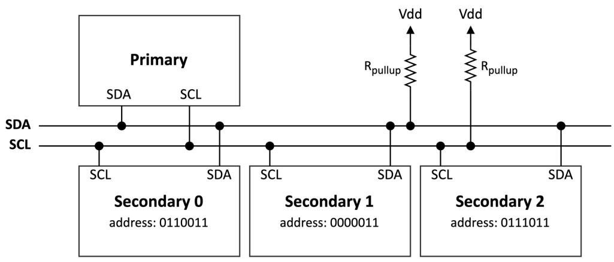
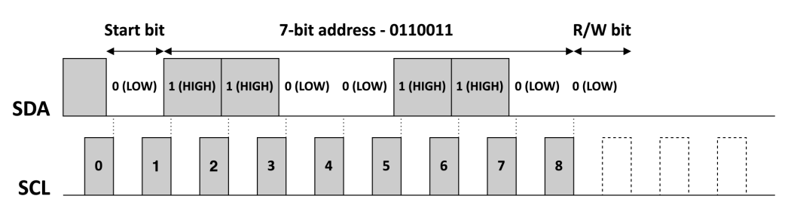
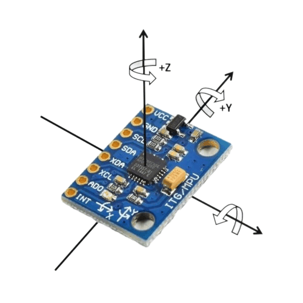
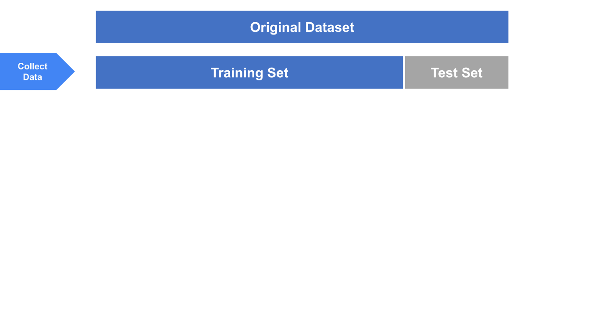
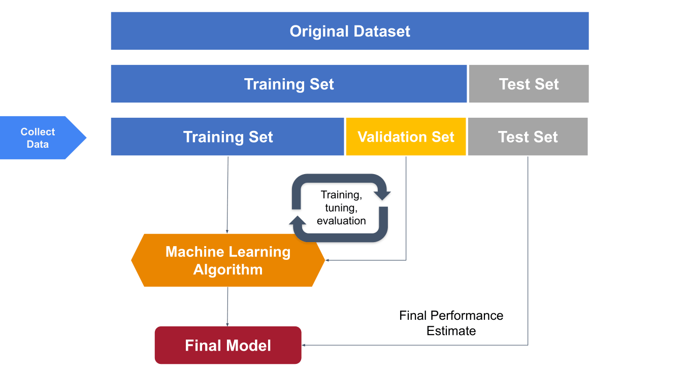
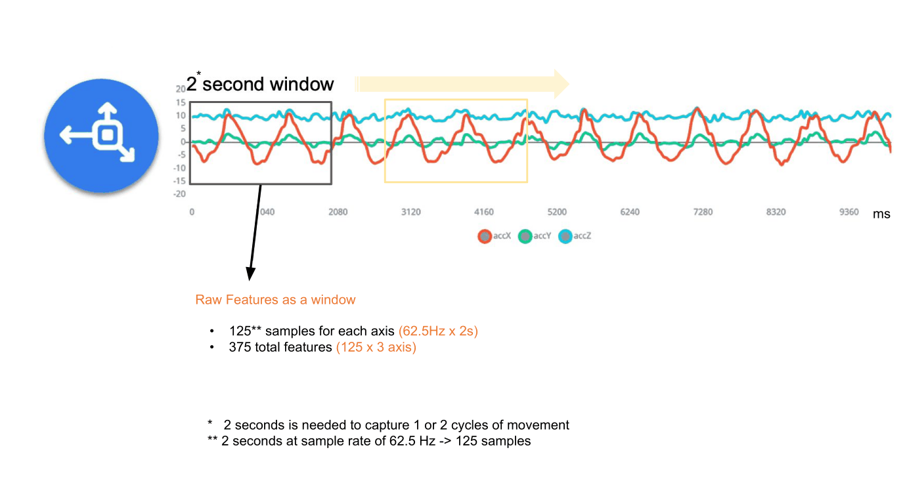

# Guia de problemas — projeto guiado de reconhecimento de movimentos

[← visão geral](README-projeto-guiado.md)

Procure pelo **sintoma** (a mensagem que aparece na tela). Antes de qualquer coisa, confira os
três clássicos: **(1)** só um programa por vez na porta serial (feche monitor/*forwarder*);
**(2)** venv ativa (`source ~/venv-ei/bin/activate`); **(3)** o contrato (62,5 Hz, `accX,accY,accZ`,
m/s², mesma montagem).

## Porta serial e ESP32

| Sintoma | Causa provável | Remédio |
|---|---|---|
| `Permission denied: '/dev/ttyUSB0'` | usuário fora do grupo `dialout`, ou grupo ainda não valeu | `sudo usermod -a -G dialout $USER` e **logout/login** (no RPi: `sudo reboot`). Confira com `groups` |
| `could not open port /dev/ttyUSB0: ... Device or resource busy` | outro programa com a porta aberta (`idf.py monitor`, *data forwarder*, outro script) | feche-o (`Ctrl+]` no monitor, `Ctrl+C` nos demais). `fuser /dev/ttyUSB0` mostra quem está usando |
| `No such file or directory: '/dev/ttyUSB0'` | cabo só de carga, porta errada, ou o `brltty` "sequestrou" o conversor | troque o cabo; `ls /dev/ttyUSB* /dev/ttyACM*`; `dmesg \| tail`; `sudo apt remove brltty` |
| Placa com CH340 aparece e some em seguida (`dmesg`: *brltty*) | `brltty` (leitor Braille) toma a porta | `sudo apt remove brltty` e reconecte |
| Linhas `ERR: MPU-6050 nao respondeu (WHO_AM_I=0x00)` | fiação I²C, alimentação, AD0 solto | refaça a Figura E1-E; rode o scanner I²C do Lab 9 |
| `WHO_AM_I=0x98` ou `0x70` | clone do MPU-6050 (ex.: MPU-6500) | troque `who != 0x68` pelo valor lido (o mapa de registradores do acelerômetro é o mesmo) |
| Valores travados (sempre iguais) | I²C falhando depois da inicialização (o firmware repete a última amostra) | mau contato: fios curtos e firmes |
| Valores "cortados" em ≈ ±39,2 m/s² | saturação do ±4 g | movimento brusco demais; suavize (ou use ±8 g **e** recolete tudo) |
| Taxa medida ≈ 100 Hz | `PERIODO_US` errado, ou voltou ao `vTaskDelayUntil` | `PERIODO_US 16000` com `esp_timer` (Etapa 2, A.4) |
| Primeiras linhas com lixo (`ets Jun 8 2016`, `rst:0x1`) | o ESP32 reinicia quando a porta é aberta (auto-reset por DTR/RTS) | normal; os scripts descartam essas linhas |
| Muitas mensagens `I (123) cpu_start: ...` | o `sdkconfig.defaults` não foi aplicado (já existia um `sdkconfig`) | `rm sdkconfig && idf.py fullclean build` |

> 🖼️ As figuras com numeração **S** (de *slides*) vêm da apresentação da disciplina *Ingestão de Dados de IMU* e estão em inglês. Nelas, *Lift* = `lift`, *Terrestrial* = `terrestrial`, *Maritime* = `maritime` e *Idle* (às vezes grafado *Iddle*) = `idle`.

Referência rápida para os problemas de I²C e MPU-6050:

*Figura GP-S1 — SDA e SCL precisam de _pull-up_ (o módulo GY-521 já tem); cada secundário responde só ao seu endereço: `0x68` com AD0 em GND, `0x69` com AD0 em 3V3.*

*Figura GP-S2 — Se o endereço enviado não for o do sensor, ninguém responde (NACK), e o firmware imprime `ERR: ...`.*

*Figura GP-S3 — Orientação dos eixos: com a placa deitada, Z ≈ +9,8 m/s². Se aparecer −9,8 ou a gravidade em X ou Y, a placa está virada.*

## *Data forwarder* e Studio

| Sintoma | Causa provável | Remédio |
|---|---|---|
| `edge-impulse-data-forwarder: command not found` | PATH sem `~/.npm-global/bin` | `source ~/.bashrc` ou novo terminal; confira `npm config get prefix` |
| `Failed to get info off device ... retrying in 5 seconds` (uma vez) | linhas de *boot* durante a detecção | espere a nova tentativa |
| `Sensor readings from device do not seem to be all numbers` (repetido) | firmware imprimindo texto na linha de dados | use o `imu_serial` sem alterações nos `printf` |
| `Error: ERR: MPU-6050 nao respondeu` | fiação | ver a seção anterior |
| Forwarder conectado ao projeto errado | configuração salva de outra vez | `edge-impulse-data-forwarder --clean --frequency 62.5` |
| `The module XXX was compiled against a different Node.js version` | Node atualizado depois da CLI | `npm uninstall -g edge-impulse-cli && npm install -g edge-impulse-cli --force` |
| No Studio, a frequência do impulso aparece como 62 ou 63 Hz | forwarder sem `--frequency 62.5` | regrave com `--frequency 62.5` (ou ajuste a frequência em *Create impulse* para 62.5) |
| Acurácia de validação alta, de teste baixa | *overfitting* ou teste com movimentos muito diferentes | mais dados e mais variados no treino; confira a divisão treino/teste por **gravação** |
| Duas classes sempre confundidas | movimentos parecidos demais | torne-os mais distintos ao gravar; mais amostras dessas duas |

Para os sintomas de *overfitting* e confusão entre classes:

*Figura GP-S4 — Teste separado do treino **por gravação**, antes de treinar.*

*Figura GP-S5 — Acurácia de teste muito menor que a de validação indica _overfitting_: falta variedade no treino.*

## Python, SDK e `.eim`

| Sintoma | Causa provável | Remédio |
|---|---|---|
| `TypeError: object of type 'ellipsis' has no len()` (ou outro erro citando `ellipsis`) | um `...` de TODO não foi substituído; acontece com cópias antigas dos scripts, que não avisam | complete os TODOs (as versões atuais de 02, 03 e 04 listam quais faltam ao rodar) |
| `error: externally-managed-environment` | `pip install` fora da venv | `source ~/venv-ei/bin/activate` (nunca `--break-system-packages`) |
| `ModuleNotFoundError: No module named 'serial'` | venv não ativa, ou pacote errado (`serial` ≠ `pyserial`) | ative a venv; `pip install pyserial` |
| `ModuleNotFoundError: No module named 'pyaudio'` | o SDK importa o módulo de áudio ao carregar | `sudo apt install python3-pyaudio` e venv com `--system-site-packages` (ou `sudo apt install portaudio19-dev python3-dev` + `pip install pyaudio`) |
| `Missing OpenCV, install via pip3 install "opencv-python..."` e o script termina | o SDK importa o módulo de imagem ao carregar | `sudo apt install python3-opencv` (ou `pip install opencv-python-headless`) |
| `A module that was compiled using NumPy 1.x cannot be run in NumPy 2.x` seguido de `Missing OpenCV` (mesmo com `python3-opencv` instalado) | um `sudo pip install` antigo deixou um NumPy 2 em `/usr/local/lib/python3.*/dist-packages`, que tem prioridade sobre o NumPy 1 do `apt`; o OpenCV do `apt` foi compilado para NumPy 1 | rode de novo o script de instalação (ele detecta e fixa, **dentro da venv**, a versão de NumPy do `apt`), ou à mão: `~/venv-ei/bin/pip install "numpy==$(dpkg-query -W -f='${Version}' python3-numpy \| sed 's/^[0-9]*://; s/[+~-].*//')"` |
| `Exception: Model file "..." is not executable` | permissão de execução perdida (ex.: `scp`) | `chmod +x modelfile*.eim` |
| `Exec format error` / `Failed to start runner` | `.eim` de outra arquitetura (x86 no RPi ou vice-versa) | Etapa 4, Parte E (`--force-target runner-linux-aarch64`) |
| `The features array is 300 elements, expected 375` | janela com tamanho errado | use `window_size` lido do modelo (TODO 4) e `extend` (não `append`) |
| Classe muda com ~2 s de atraso | janela de 2 s | esperado (Etapa 3, Q4) |
| Sempre a mesma classe, qualquer movimento | contrato quebrado (unidade, eixos, orientação) ou modelo de outro projeto | compare 1 linha da serial com os dados do Studio; baixe de novo o `.eim` com `--clean` |
| Latência crescendo com o tempo | o script não acompanha a serial (atraso acumulado no *buffer*) | aumente `STRIDE`; feche programas pesados; no RPi confira `top` |

Para o erro `The features array is ... expected 375`:

*Figura GP-S6 — O modelo espera 125 amostras × 3 eixos = 375 números, numa lista achatada.*

## Raspberry Pi

| Sintoma | Causa provável | Remédio |
|---|---|---|
| `ssh: Could not resolve hostname bancadaN.local` | primeiro boot ainda em curso; Wi-Fi errado; mDNS bloqueado | espere 2 min; regrave conferindo SSID/país; use o IP |
| `WARNING: REMOTE HOST IDENTIFICATION HAS CHANGED!` | o cartão foi regravado (chave nova) | `ssh-keygen -R bancadaN.local` e conecte de novo |
| RPi reinicia sozinho / `Undervoltage detected` no `dmesg` | fonte fraca, cabo fino | fonte ≥ 2,5 A, cabo curto |
| `apt` muito lento / travado | primeira atualização, cartão lento | paciência; não desligue no meio (`sudo dpkg --configure -a` se interrompido) |
| Instalação da CLI (`--com-cli`) leva > 40 min | compilação de módulos nativos no RPi 3 | use o Caminho A da Etapa 4 (baixar o `.eim` no PC) |
